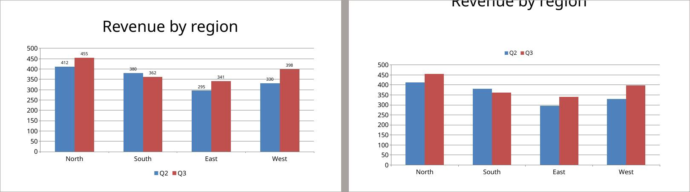

# Do the docx and powerpoint skills make konrad's Word and PowerPoint work better?

*A/B test report · office-skills · 2026-10-28*

**Of 6 tasks, A was better in 2, B in 0, and 4 showed no real difference.**

> **In short.** Two versions of konrad, A (main, without the docx and powerpoint skills) and B (with the docx and powerpoint skills (and the layout repair on the create tasks)), did the same 6 tasks, 10 times each, with the same AI model. Every result was checked automatically for hard facts, and every pair of results was compared by AI reviewers who didn't know which version made which.

| task | outcome | pairs: A better / no difference / B better | checks passed A / B | tokens read A / B (k) |
| --- | --- | --- | --- | --- |
| [pptx-create-deck](#31-pptx-create-deck-a-clearly-better) | A clearly better | 10 / 0 / 0 | 99% / 90% | 388 / 392 |
| [pptx-edit-deck](#32-pptx-edit-deck-a-clearly-better) | A clearly better | 5 / 5 / 0 | 100% / 100% | 265 / 287 |
| [docx-create-report](#33-docx-create-report-no-real-difference) | no real difference | 0 / 9 / 1 | 100% / 100% | 220 / 349 |
| [docx-edit-contract](#34-docx-edit-contract-no-real-difference) | no real difference | 0 / 9 / 1 | 98% / 100% | 257 / 288 |
| [docx-review-revisions](#35-docx-review-revisions-no-real-difference) | no real difference | 0 / 10 / 0 | 100% / 100% | 200 / 214 |
| [pptx-duplicate-cards](#36-pptx-duplicate-cards-no-real-difference) | no real difference | 0 / 10 / 0 | 100% / 100% | 289 / 326 |

## 1. What was compared

| | A | B |
| --- | --- | --- |
| version | main, without the docx and powerpoint skills | with the docx and powerpoint skills (and the layout repair on the create tasks) |
| image | `konrad:ab-main` | `konrad:ab-bridge (create tasks), konrad:ab-office (edit tasks)` |

Both versions ran with `anthropic/claude-haiku-5-5 (low effort)`. Each request ended with: “If one of your skills covers this file type, load it with the skill tool before you start, and follow it.” The tasks:

- **pptx-create-deck**: “Make a 16:9 deck quarterly-review.pptx for Friday's sales meeting, five slides in this order.”
- **pptx-edit-deck**: “In deck.pptx, our product Alpha has been renamed Aurora: rename it everywhere in the deck, speaker notes and the chart included.”
- **docx-create-report**: “Write our Q3 project status report as status-report.docx, A4.”
- **docx-edit-contract**: “Our client Nordlicht GmbH is now called Polarstern AG.”
- **docx-review-revisions**: “review.docx has tracked changes from two reviewers.”
- **pptx-duplicate-cards**: “team.pptx has a profile card on slide 2.”

## 2. How

1. **Same task, same input, 10 runs per version.** Run 1 of A and run 1 of B form a *pair*, and so on.
1. **Automatic checks.** Each task has a small test that checks fixed facts about the result (is the old name gone, is the chart there). They tell whether a result is correct, not whether it is good.
1. **Blind review.** An AI reviewer (Sonnet at medium effort) gets the request, the input and both results as page images and text, labelled only “X” and “Y” in random order. It scores both on *request* (did it do what was asked), *fidelity* (is the data right) and *presentation* (could you hand it on as it is), and says which it would rather receive, or that it makes no difference.
1. **Each pair is reviewed twice,** by different reviewers, with X and Y swapped. A pair counts as a win only if both reviews pick the same version, otherwise as no difference. Here they agreed in 46 of 60 pairs.
1. **A task's outcome** is “clearly better” when one version wins at least half of all pairs more than the other, “somewhat better” when it wins at least two more, and “no real difference” otherwise.

## 3. Results

Per task: the outcome, what a reviewer saw, and where one version won, the pages that show it (A left, B right). All numbers and more reasons are folded away under each task.

### 3.1 pptx-create-deck: A clearly better

*“Make a 16:9 deck quarterly-review.pptx for Friday's sales meeting, five slides in this order.”*

A better in 10 pairs, no difference in 0, B better in 0; the two reviews agreed in 10 of 10. Automatic checks passed: A 99%, B 90%.

**A reviewer on run 6:** B's titles on slides 2, 4 and 5 are pushed up and clipped at the top edge, and slide 3 title is cut off; A titles are intact on every slide. A also right-aligns the revenue column and labels the chart bars.

*Run 6, quarterly-review.pptx, slide 3: A left, B right.*

All numbers

| | A | B |
| --- | --- | --- |
| automatic checks passed | 99% (9 of 10 runs flawless) | 90% (9 of 10 runs flawless) |
| review score: request | 5.0 / 5 | 4.2 / 5 |
| review score: fidelity | 5.0 / 5 | 4.5 / 5 |
| review score: presentation | 4.6 / 5 | 3.4 / 5 |
| time per run | 54 s | 36 s |
| tokens read / written per run | 388k / 7.5k | 392k / 5.6k |
| cost per run | $0.0095 | $0.0100 |
| runs that used a skill | 0 of 10 | 10 of 10 |

More reviewers' reasons

- **Run 9, A better:** B delivered no file (MISSING.txt). A is a complete five-slide deck with the editable clustered chart with value labels, full table with correct umlauts, and one-sentence notes on slides 2-5.
- **Run 10, A better:** Slide 3 chart in B has no legend, so the reader cannot tell Q2 from Q3 bars; A has a legend and value labels. Other slides, table and notes are equivalent.
- **Run 7, A better:** Both are complete; A's chart has value labels and a bottom legend, while B's chart has no data labels and a side legend that squeezes the plot.

### 3.2 pptx-edit-deck: A clearly better

*“In deck.pptx, our product Alpha has been renamed Aurora: rename it everywhere in the deck, speaker notes and the chart included.”*

A better in 5 pairs, no difference in 5, B better in 0; the two reviews agreed in 6 of 10. Automatic checks passed: A 100%, B 100%.

**A reviewer on run 1:** Both complete every requested edit identically (rename in slides, notes and chart, Q3 1640, Q4 2100, Old roadmap deleted, Summary last). On slide 3 B's chart title renders larger and the plot area shifted compared with the input, a formatting change nobody asked for; A keeps the input's chart title size and layout.

*Run 1, deck-v2.pptx, slide 3: A left, B right.*

All numbers

| | A | B |
| --- | --- | --- |
| automatic checks passed | 100% (10 of 10 runs flawless) | 100% (10 of 10 runs flawless) |
| review score: request | 5.0 / 5 | 5.0 / 5 |
| review score: fidelity | 5.0 / 5 | 4.3 / 5 |
| review score: presentation | 5.0 / 5 | 4.8 / 5 |
| time per run | 37 s | 37 s |
| tokens read / written per run | 265k / 5.3k | 287k / 4.5k |
| cost per run | $0.0069 | $0.0070 |
| runs that used a skill | 0 of 10 | 10 of 10 |

More reviewers' reasons

- **Run 2, no difference:** Both decks are structurally identical: Alpha renamed to Aurora everywhere including notes and chart, Q3 1640, Q4 2100, Old roadmap deleted, Summary last. The only difference is the chart title on slide 3: A keeps the original smaller title size, the other renders it larger, a tiny unrequested change.
- **Run 3, A better:** Both decks are structurally identical: Alpha renamed to Aurora everywhere including notes and chart, Q3 1640, Q4 2100, Old roadmap deleted, Summary last. The only difference is the chart title on slide 3: A keeps the original smaller title size, the other renders it larger, a tiny unrequested change.
- **Run 6, A better:** Both complete every requested edit identically (rename in slides, notes and chart, Q3 1640, Q4 2100, Old roadmap deleted, Summary last). On slide 3 B's chart title renders larger and the plot area shifted compared with the input, a formatting change nobody asked for; A keeps the input's chart title size and layout.

### 3.3 docx-create-report: no real difference

*“Write our Q3 project status report as status-report.docx, A4.”*

A better in 0 pairs, no difference in 9, B better in 1; the two reviews agreed in 6 of 10. Automatic checks passed: A 100%, B 100%.

**A reviewer on run 1:** Both are complete and identical in layout. B adds a closed on 12 September detail and until results are in; A adds needs attention in Q4. Both summaries are slightly long but accurate, so no meaningful difference.

All numbers

| | A | B |
| --- | --- | --- |
| automatic checks passed | 100% (10 of 10 runs flawless) | 100% (10 of 10 runs flawless) |
| review score: request | 4.8 / 5 | 4.9 / 5 |
| review score: fidelity | 5.0 / 5 | 5.0 / 5 |
| review score: presentation | 4.2 / 5 | 4.2 / 5 |
| time per run | 32 s | 32 s |
| tokens read / written per run | 220k / 4.2k | 349k / 4.2k |
| cost per run | $0.0058 | $0.0081 |
| runs that used a skill | 0 of 10 | 10 of 10 |

More reviewers' reasons

- **Run 10, B better:** Both deliver all sections, bold header table, bullets, numbered list and Page 1 of 1 footer, and are visually near identical. A's summary runs to three sentences and adds next-step content, which is less of the one short paragraph asked for; B is tighter.
- **Run 2, no difference:** Both meet every requirement with correct data and bold header. A centers the Page 1 of 1 footer and B leaves it left-aligned; B's one-line summary is shorter but both fit.
- **Run 3, no difference:** Both fulfil every element with the same layout. B's summary is shorter and omits the two branches; A states more but is still short. Differences are negligible.

### 3.4 docx-edit-contract: no real difference

*“Our client Nordlicht GmbH is now called Polarstern AG.”*

A better in 0 pairs, no difference in 9, B better in 1; the two reviews agreed in 10 of 10. Automatic checks passed: A 98%, B 100%.

**A reviewer on run 1:** B and A have identical outlines, extracted text and page images. Both replace Nordlicht GmbH with Polarstern AG in the header, footer, body, table and signature block. Both show 30 to 45 as one tracked deletion and one tracked insertion, and both add the comment 'Please confirm the cap.' (outline.json lists it, with author konrad). The banner image still reads NORDLICHT in both, and neither could change it.

All numbers

| | A | B |
| --- | --- | --- |
| automatic checks passed | 98% (9 of 10 runs flawless) | 100% (10 of 10 runs flawless) |
| review score: request | 4.5 / 5 | 4.8 / 5 |
| review score: fidelity | 4.5 / 5 | 4.8 / 5 |
| review score: presentation | 4.5 / 5 | 4.8 / 5 |
| time per run | 36 s | 37 s |
| tokens read / written per run | 257k / 6.1k | 288k / 5.2k |
| cost per run | $0.0072 | $0.0071 |
| runs that used a skill | 0 of 10 | 10 of 10 |

More reviewers' reasons

- **Run 7, B better:** A left 'Nordlicht GmbH' in clause 1 Scope, so the name was not replaced everywhere. B replaced it in the body, table, header and footer, and both have the tracked 30 to 45 change and the comment on the Liability heading.
- **Run 2, no difference:** B and A have identical outlines, extracted text and page images. Both replace Nordlicht GmbH with Polarstern AG in the header, footer, body, table and signature block. Both show 30 to 45 as one tracked deletion and one tracked insertion, and both add the comment 'Please confirm the cap.' (outline.json lists it, with author konrad). The banner image still reads NORDLICHT in both, and neither could change it.
- **Run 3, no difference:** Outline, text and page image are identical: name replaced in body, table, header and footer, 30 to 45 tracked, comment on the Liability heading. Neither changed the NORDLICHT logo image.

### 3.5 docx-review-revisions: no real difference

*“review.docx has tracked changes from two reviewers.”*

A better in 0 pairs, no difference in 10, B better in 0; the two reviews agreed in 10 of 10. Automatic checks passed: A 100%, B 100%.

**A reviewer on run 1:** Both outlines are identical: all tracked changes resolved, same text, table and comments kept, and comments.txt has the same three lines in the requested format. No difference visible to the user.

All numbers

| | A | B |
| --- | --- | --- |
| automatic checks passed | 100% (10 of 10 runs flawless) | 100% (10 of 10 runs flawless) |
| review score: request | 4.8 / 5 | 4.8 / 5 |
| review score: fidelity | 4.8 / 5 | 4.8 / 5 |
| review score: presentation | 4.8 / 5 | 4.8 / 5 |
| time per run | 27 s | 26 s |
| tokens read / written per run | 200k / 4.0k | 214k / 2.9k |
| cost per run | $0.0052 | $0.0049 |
| runs that used a skill | 0 of 10 | 10 of 10 |

More reviewers' reasons

- **Run 2, no difference:** A and B are identical in text, outline (no tracked changes left, all three comments kept in place) and page image, and comments.txt matches line for line. Nothing separates them.
- **Run 3, no difference:** A and B are identical in text, outline (no tracked changes left, all three comments kept in place) and page image, and comments.txt matches line for line. Nothing separates them.
- **Run 4, no difference:** Both outlines are identical: all tracked changes resolved, same text, table and comments kept, and comments.txt has the same three lines in the requested format. No difference visible to the user.

### 3.6 pptx-duplicate-cards: no real difference

*“team.pptx has a profile card on slide 2.”*

A better in 0 pairs, no difference in 10, B better in 0; the two reviews agreed in 4 of 10. Automatic checks passed: A 100%, B 100%.

**A reviewer on run 1:** Both decks have the title slide plus four cards in CSV order, with the template card removed, names, roles and Intro notes correct (umlauts intact), and slide numbers 2-5 on all but the title slide. Page images are byte-identical; the only outline difference is the cached slide-number placeholder text, which renders the same.

All numbers

| | A | B |
| --- | --- | --- |
| automatic checks passed | 100% (10 of 10 runs flawless) | 100% (10 of 10 runs flawless) |
| review score: request | 4.9 / 5 | 5.0 / 5 |
| review score: fidelity | 5.0 / 5 | 5.0 / 5 |
| review score: presentation | 4.5 / 5 | 4.5 / 5 |
| time per run | 42 s | 42 s |
| tokens read / written per run | 289k / 5.3k | 326k / 5.3k |
| cost per run | $0.0069 | $0.0082 |
| runs that used a skill | 0 of 10 | 10 of 10 |

More reviewers' reasons

- **Run 8, no difference:** Both decks have the title slide plus four cards in CSV order with correct names, roles, umlauts, photos, layout and 'Intro: Name' notes; the template card is gone. Slide numbers appear on slides 2-5 and not on the title slide in both; the page images are visually identical. Only the outline text of the number placeholders differs, which does not change the rendering.
- **Run 2, no difference:** Both decks have the title slide plus four cards in CSV order with correct names, roles, umlauts, photos, layout and 'Intro: Name' notes; the template card is gone. Slide numbers appear on slides 2-5 and not on the title slide in both; the page images are visually identical. Only the outline text of the number placeholders differs, which does not change the rendering.
- **Run 3, no difference:** Both decks have the title slide plus four cards in CSV order with correct names, roles, umlauts, photos, layout and 'Intro: Name' notes; the template card is gone. Slide numbers appear on slides 2-5 and not on the title slide in both; the page images are visually identical. Only the outline text of the number placeholders differs, which does not change the rendering.

## 4. Limits

- 10 pairs per task show clear differences, not subtle ones.
- The reviewers are AI models. They agreed with themselves as shown above, but nobody checked every verdict by hand.
- The runs used `anthropic/claude-haiku-5-5 (low effort)`; another model, such as the local one konrad is tuned for, may behave differently.
- The reviewers are kept blind by instruction: they could have looked at other files on disk.
