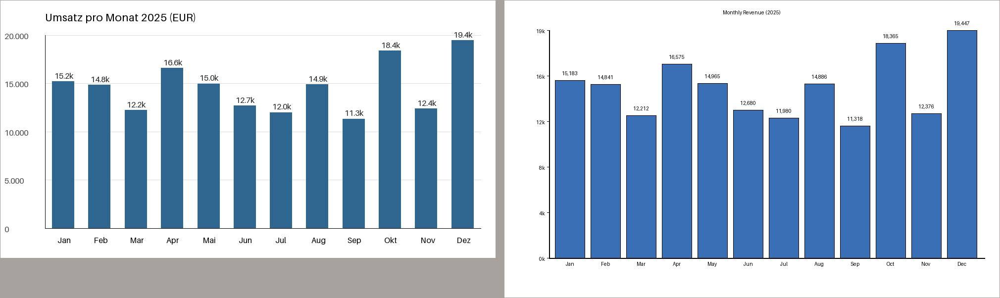
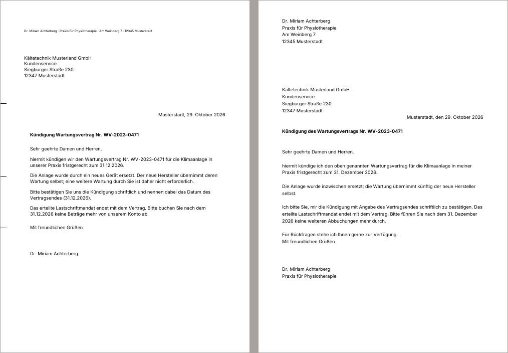
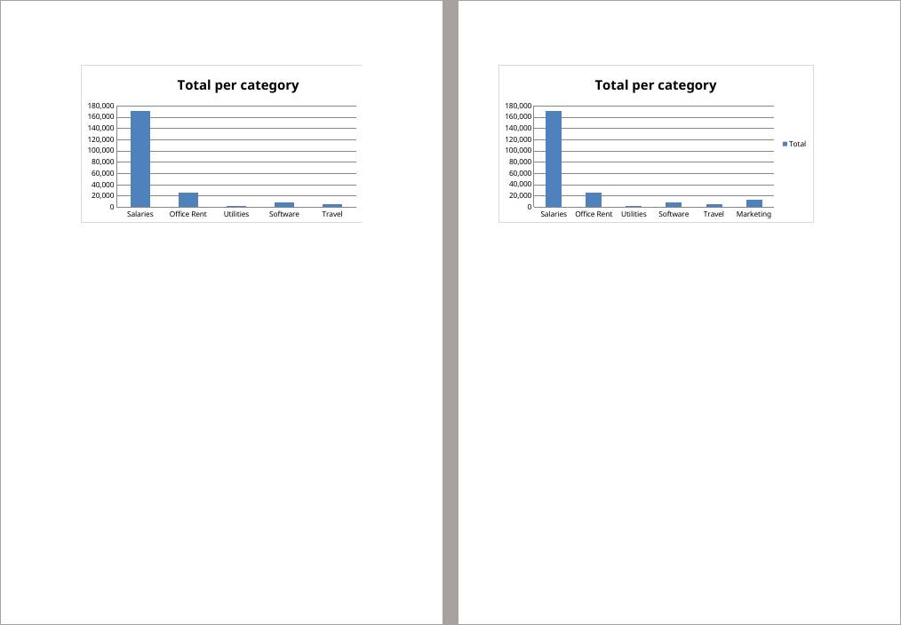

# How does Qwen3.8 27B compare with Haiku 5.5 on konrad's tasks?

*A/B test report · models-27b · 2026-10-29*

**Of 17 tasks, Haiku was better in 7, Qwen 27B in 1, and 9 showed no real difference.**

> **In short.** Two AI models, Haiku (Claude Haiku 5.5 at low effort) and Qwen 27B (Qwen3.8 27B via OpenRouter, at its default effort), did the same 17 tasks in konrad, 5 times each. Every result was checked automatically for hard facts, and every pair of results was compared by AI reviewers who didn't know which version made which.

| task | outcome | pairs: Haiku better / no difference / Qwen 27B better | checks passed Haiku / Qwen 27B | tokens read Haiku / Qwen 27B (k) |
| --- | --- | --- | --- | --- |
| [csv-analysis](#31-csv-analysis-haiku-clearly-better) | Haiku clearly better | 4 / 1 / 0 | 100% / 100% | 296 / 380 |
| [docx-create-report](#32-docx-create-report-haiku-somewhat-better) | Haiku somewhat better | 2 / 3 / 0 | 100% / 100% | 230 / 716 |
| [docx-edit-contract](#33-docx-edit-contract-haiku-clearly-better) | Haiku clearly better | 3 / 2 / 0 | 100% / 100% | 252 / 977 |
| [long-minutes](#34-long-minutes-haiku-somewhat-better) | Haiku somewhat better | 2 / 3 / 0 | 100% / 91% | 703 / 624 |
| [pdf-letter](#35-pdf-letter-haiku-clearly-better) | Haiku clearly better | 4 / 0 / 1 | 80% / 95% | 174 / 714 |
| [pptx-create-deck](#36-pptx-create-deck-haiku-clearly-better) | Haiku clearly better | 4 / 1 / 0 | 100% / 99% | 342 / 733 |
| [receipt-photo](#37-receipt-photo-haiku-somewhat-better) | Haiku somewhat better | 2 / 3 / 0 | 100% / 100% | 101 / 166 |
| [xlsx-edit-budget](#38-xlsx-edit-budget-qwen-27b-clearly-better) | Qwen 27B clearly better | 0 / 0 / 5 | 94% / 100% | 152 / 1278 |
| [code-fix](#39-code-fix-no-real-difference) | no real difference | 0 / 5 / 0 | 100% / 100% | 141 / 155 |
| [docx-review-revisions](#310-docx-review-revisions-no-real-difference) | no real difference | 0 / 5 / 0 | 100% / 100% | 175 / 513 |
| [eml-reply-quote](#311-eml-reply-quote-no-real-difference) | no real difference | 2 / 1 / 2 | 100% / 100% | 292 / 891 |
| [files-sort](#312-files-sort-no-real-difference) | no real difference | 1 / 2 / 2 | 100% / 100% | 144 / 260 |
| [pdf-extract-table](#313-pdf-extract-table-no-real-difference) | no real difference | 0 / 5 / 0 | 100% / 100% | 118 / 353 |
| [pptx-duplicate-cards](#314-pptx-duplicate-cards-no-real-difference) | no real difference | 1 / 4 / 0 | 100% / 99% | 312 / 1031 |
| [pptx-edit-deck](#315-pptx-edit-deck-no-real-difference) | no real difference | 0 / 5 / 0 | 100% / 100% | 299 / 948 |
| [xlsx-create-report](#316-xlsx-create-report-no-real-difference) | no real difference | 1 / 2 / 2 | 100% / 100% | 164 / 430 |
| [xlsx-csv-locale](#317-xlsx-csv-locale-no-real-difference) | no real difference | 1 / 4 / 0 | 100% / 100% | 174 / 450 |

## 1. What was compared

| | Haiku | Qwen 27B |
| --- | --- | --- |
| version | Claude Haiku 5.5 at low effort | Qwen3.8 27B via OpenRouter, at its default effort |
| image | `konrad:local` | `konrad:local` |
| model | `anthropic/claude-haiku-5-5 (low effort)` | `openrouter/qwen/qwen3.8-27b (default effort)` |

The tasks:

- **csv-analysis**: “verkaeufe.csv holds last year's sales.”
- **docx-create-report**: “Write our Q3 project status report as status-report.docx, A4.”
- **docx-edit-contract**: “Our client Nordlicht GmbH is now called Polarstern AG.”
- **long-minutes**: “protokolle.md holds two years of minutes of our sports club's board.”
- **pdf-letter**: “Write the letter from my notes in notizen.txt as brief.pdf: a one-page German business letter laid out to DIN 5008, ready to print, sign and send in a window envelope.”
- **pptx-create-deck**: “Make a 16:9 deck quarterly-review.pptx for Friday's sales meeting, five slides in this order.”
- **receipt-photo**: “beleg.jpg is a photo of a receipt.”
- **xlsx-edit-budget**: “budget.xlsx is our department budget.”
- **code-fix**: “rechnung.py adds up our invoices, but the tests in test_rechnung.py fail.”
- **docx-review-revisions**: “review.docx has tracked changes from two reviewers.”
- **eml-reply-quote**: “anfrage.eml is a customer's request for a quote.”
- **files-sort**: “The PDFs in post/ are letters I scanned, with meaningless file names.”
- **pdf-extract-table**: “bericht.pdf is our quarterly report.”
- **pptx-duplicate-cards**: “team.pptx has a profile card on slide 2.”
- **pptx-edit-deck**: “In deck.pptx, our product Alpha has been renamed Aurora: rename it everywhere in the deck, speaker notes and the chart included.”
- **xlsx-create-report**: “sales.csv holds this quarter's sales.”
- **xlsx-csv-locale**: “export.csv is an export from our German accounting tool.”

## 2. How

1. **Same task, same input, 5 runs per version.** Run 1 of Haiku and run 1 of Qwen 27B form a *pair*, and so on.
1. **Automatic checks.** Each task has a small test that checks fixed facts about the result (is the old name gone, is the chart there). They tell whether a result is correct, not whether it is good.
1. **Blind review.** An AI reviewer (Sonnet at medium effort) gets the request, the input and both results as page images and text, labelled only “X” and “Y” in random order. It scores both on *request* (did it do what was asked), *fidelity* (is the data right) and *presentation* (could you hand it on as it is), and says which it would rather receive, or that it makes no difference.
1. **Each pair is reviewed twice,** by different reviewers, with X and Y swapped. A pair counts as a win only if both reviews pick the same version, otherwise as no difference. Here they agreed in 72 of 85 pairs.
1. **A task's outcome** is “clearly better” when one version wins at least half of all pairs more than the other, “somewhat better” when it wins at least two more, and “no real difference” otherwise.

## 3. Results

Per task: the outcome, what a reviewer saw, and where one version won, the pages that show it (Haiku left, Qwen 27B right). All numbers and more reasons are folded away under each task.

### 3.1 csv-analysis: Haiku clearly better

*“verkaeufe.csv holds last year's sales.”*

Haiku better in 4 pairs, no difference in 1, Qwen 27B better in 0; the two reviews agreed in 4 of 5. Automatic checks passed: Haiku 100%, Qwen 27B 100%.

**A reviewer on run 3:** All figures are correct on both sides. Haiku has a clean, readable chart with a proper title and thousands-separated axis, and flags the three duplicate rows with the exact amount. Qwen 27B chart has a tiny title, heavy black outlines and an odd 19k/0k axis, and the document does not mention the duplicates.

*Run 3, umsatz.png, page 1: Haiku left, Qwen 27B right.*

All numbers

| | Haiku | Qwen 27B |
| --- | --- | --- |
| automatic checks passed | 100% (5 of 5 runs flawless) | 100% (5 of 5 runs flawless) |
| review score: request | 5.0 / 5 | 4.7 / 5 |
| review score: fidelity | 4.9 / 5 | 4.9 / 5 |
| review score: presentation | 4.1 / 5 | 3.5 / 5 |
| time per run | 39 s | 74 s |
| tokens read / written per run | 296k / 5.8k | 380k / 9.0k |
| cost per run | $0.0072 | $0.0133 |
| runs that used a skill | 0 of 5 | 0 of 5 |

More reviewers' reasons

- **Run 1, Haiku better:** Haiku has correct tables, a duplicate note and a clean chart (only a small glyph glitch on Maer). Qwen 27B chart highlights January in blue while all other bars are dark grey, and the Hoechster Umsatz label sits over December, so the highlight is misleading and looks like a bug.
- **Run 5, no difference:** Haiku has a total row, record counts and a note on the duplicate rows, and a clean chart (small glyph glitch on Maer). Qwen 27B chart value labels collide with the bar tops, looking struck through, and Qwen 27B says nothing about the duplicates.
- **Run 4, Haiku better:** Both are correct and complete. Haiku adds a total row and flags the three exact duplicate rows (279.30 EUR) for confirmation, which Qwen 27B silently includes. Haiku chart has German labels inside an English document, a small inconsistency, while Qwen 27B chart is consistent and clean.

### 3.2 docx-create-report: Haiku somewhat better

*“Write our Q3 project status report as status-report.docx, A4.”*

Haiku better in 2 pairs, no difference in 3, Qwen 27B better in 0; the two reviews agreed in 3 of 5. Automatic checks passed: Haiku 100%, Qwen 27B 100%.

**A reviewer on run 2:** Layout and structure are identical. Qwen 27B's summary says the pilot was completed on schedule, a claim the CSV does not state; Haiku sticks to the facts.

All numbers

| | Haiku | Qwen 27B |
| --- | --- | --- |
| automatic checks passed | 100% (5 of 5 runs flawless) | 100% (5 of 5 runs flawless) |
| review score: request | 5.0 / 5 | 5.0 / 5 |
| review score: fidelity | 5.0 / 5 | 4.5 / 5 |
| review score: presentation | 4.5 / 5 | 4.5 / 5 |
| time per run | 31 s | 196 s |
| tokens read / written per run | 230k / 4.3k | 716k / 23.6k |
| cost per run | $0.0057 | $0.0335 |
| runs that used a skill | 0 of 5 | 0 of 5 |

More reviewers' reasons

- **Run 1, no difference:** Identical layout and structure; Qwen 27B's summary is one terse sentence, Haiku's adds the go-live date. Neither difference matters.
- **Run 3, Haiku better:** Layout is identical. Qwen 27B's summary says the data model is signed off and the pilot was on time, which the CSV does not say (the model was reviewed); Haiku stays with the data.
- **Run 4, no difference:** Both deliver the same A4 layout, bold header row, real lists, Page Qwen 27B of Haiku footer; only the summary wording differs (Qwen 27B a little longer, Haiku shorter and closer to one short paragraph).

### 3.3 docx-edit-contract: Haiku clearly better

*“Our client Nordlicht GmbH is now called Polarstern AG.”*

Haiku better in 3 pairs, no difference in 2, Qwen 27B better in 0; the two reviews agreed in 4 of 5. Automatic checks passed: Haiku 100%, Qwen 27B 100%.

**A reviewer on run 1:** Both attempts rename every occurrence (body, table, header, footer), show the tracked 30 to 45 change in clause 4 and attach the comment to the Liability heading; the pages look identical. The only difference is the comment author: 'Polarstern AG' on the losing side attributes the comment to the client, while the winner uses the neutral 'konrad'.

All numbers

| | Haiku | Qwen 27B |
| --- | --- | --- |
| automatic checks passed | 100% (5 of 5 runs flawless) | 100% (5 of 5 runs flawless) |
| review score: request | 5.0 / 5 | 5.0 / 5 |
| review score: fidelity | 5.0 / 5 | 4.6 / 5 |
| review score: presentation | 5.0 / 5 | 5.0 / 5 |
| time per run | 37 s | 300 s |
| tokens read / written per run | 252k / 5.9k | 977k / 25.9k |
| cost per run | $0.0070 | $0.0377 |
| runs that used a skill | 0 of 5 | 0 of 5 |

More reviewers' reasons

- **Run 4, no difference:** Both attempts rename every occurrence, make the tracked 30 to 45 change in clause 4 and add the comment to the Liability heading, with identical pages. Only the comment author differs ('konrad' versus 'Konrad'), which does not matter.
- **Run 2, Haiku better:** Both attempts rename every occurrence (body, table, header, footer), show the tracked 30 to 45 change in clause 4 and attach the comment to the Liability heading; the pages look identical. The only difference is the comment author: 'Polarstern AG' on the losing side attributes the comment to the client, while the winner uses the neutral 'konrad'.
- **Run 3, Haiku better:** Both attempts rename every occurrence (body, table, header, footer), show the tracked 30 to 45 change in clause 4 and attach the comment to the Liability heading; the pages look identical. The only difference is the comment author: 'Polarstern AG' on the losing side attributes the comment to the client, while the winner uses the neutral 'konrad'.

### 3.4 long-minutes: Haiku somewhat better

*“protokolle.md holds two years of minutes of our sports club's board.”*

Haiku better in 2 pairs, no difference in 3, Qwen 27B better in 0; the two reviews agreed in 3 of 5. Automatic checks passed: Haiku 100%, Qwen 27B 91%.

**A reviewer on run 1:** Both tables list the same six correct decisions and mark the festival budget as reversed. Qwen 27B is written in English for a German club's minutes, with an awkward 'renovation of the pitch on pitch 1', a totals line and an extra excluded table. Haiku matches the language of the input and is clean and complete.

All numbers

| | Haiku | Qwen 27B |
| --- | --- | --- |
| automatic checks passed | 100% (5 of 5 runs flawless) | 91% (0 of 5 runs flawless) |
| review score: request | 5.0 / 5 | 4.4 / 5 |
| review score: fidelity | 5.0 / 5 | 4.9 / 5 |
| review score: presentation | 5.0 / 5 | 4.0 / 5 |
| time per run | 57 s | 75 s |
| tokens read / written per run | 703k / 7.3k | 624k / 10.5k |
| cost per run | $0.0367 | $0.0177 |
| runs that used a skill | 0 of 5 | 0 of 5 |

More reviewers' reasons

- **Run 3, no difference:** Both tables are correct and in German. Haiku flags each row valid or reversed; Qwen 27B has an explicit Ja or Nein column for later reversal with the reason. Differences are cosmetic.
- **Run 2, Haiku better:** Content is identical and correct in both. Qwen 27B is in English with ISO dates and an excluded list, which doesn't suit German minutes. Haiku is in German with German date and number formats and marks the reversal in the Status column.
- **Run 4, no difference:** Both list the six correct decisions with correct amounts and mark the festival budget as reversed on 11.03.2025, in German. Haiku adds a vote column and totals; Qwen 27B adds a list of excluded proposals. Neither difference changes the value to the user.

### 3.5 pdf-letter: Haiku clearly better

*“Write the letter from my notes in notizen.txt as brief.pdf: a one-page German business letter laid out to DIN 5008, ready to print, sign and send in a window envelope.”*

Haiku better in 4 pairs, no difference in 0, Qwen 27B better in 1; the two reviews agreed in 5 of 5. Automatic checks passed: Haiku 80%, Qwen 27B 95%.

**A reviewer on run 2:** Haiku has the DIN 5008 elements: a return-address line above the window, the recipient block at window height and fold marks. Qwen 27B has no return-address line or fold marks, and its address block sits too low for a window envelope. Content is correct in both.

*Run 2, brief.pdf, page 1: Haiku left, Qwen 27B right.*

All numbers

| | Haiku | Qwen 27B |
| --- | --- | --- |
| automatic checks passed | 80% (4 of 5 runs flawless) | 95% (2 of 5 runs flawless) |
| review score: request | 3.6 / 5 | 2.3 / 5 |
| review score: fidelity | 4.1 / 5 | 4.4 / 5 |
| review score: presentation | 3.4 / 5 | 2.5 / 5 |
| time per run | 31 s | 203 s |
| tokens read / written per run | 174k / 4.6k | 714k / 27.8k |
| cost per run | $0.0051 | $0.0387 |
| runs that used a skill | 1 of 5 | 5 of 5 |

More reviewers' reasons

- **Run 5, Haiku better:** Qwen 27B puts the recipient block right-aligned on the right, which does not fit a window envelope, and has no return-address line or fold marks. Haiku has the return-address line, a left-aligned window address and fold marks. Haiku is brief and complete. Qwen 27B's explicit 1 January 2027 is fine but does not make up for the layout.
- **Run 4, Qwen 27B better:** Haiku did not deliver a PDF. Qwen 27B is a real one-page letter with correct content, though its layout is weak: the recipient block is crammed against the date and subject, and the sender sits top right.
- **Run 3, Haiku better:** Haiku has a return-address line, a left-aligned recipient block in the window area and fold marks. Qwen 27B puts recipient and sender side by side in a cramped row with the date, with no clear window address area, and it adds a page footer. The text is correct in both.

### 3.6 pptx-create-deck: Haiku clearly better

*“Make a 16:9 deck quarterly-review.pptx for Friday's sales meeting, five slides in this order.”*

Haiku better in 4 pairs, no difference in 1, Qwen 27B better in 0; the two reviews agreed in 5 of 5. Automatic checks passed: Haiku 100%, Qwen 27B 99%.

**A reviewer on run 4:** Qwen 27B's title, subtitle and slide titles are mispositioned at the top edge of slides 1, 2 and 5, clipped and overlapping the bullets (slide 3 title is cut off too). Haiku renders cleanly throughout with labeled chart and tidy table.

*Run 4, quarterly-review.pptx, slide 1: Haiku left, Qwen 27B right.*

All numbers

| | Haiku | Qwen 27B |
| --- | --- | --- |
| automatic checks passed | 100% (5 of 5 runs flawless) | 99% (4 of 5 runs flawless) |
| review score: request | 5.0 / 5 | 4.4 / 5 |
| review score: fidelity | 5.0 / 5 | 4.7 / 5 |
| review score: presentation | 4.6 / 5 | 3.3 / 5 |
| time per run | 44 s | 151 s |
| tokens read / written per run | 342k / 6.7k | 733k / 18.1k |
| cost per run | $0.0081 | $0.0277 |
| runs that used a skill | 0 of 5 | 0 of 5 |

More reviewers' reasons

- **Run 2, no difference:** Both decks are complete and correct, with data labels on the slide 3 chart and a full table on slide 4. Differences are minor: Haiku has smaller chart labels, Qwen 27B has larger ones and a slightly more spaced table.
- **Run 1, Haiku better:** Qwen 27B has no speaker note on slide 3, which the task required for slides 2 to 5; Haiku has all four notes. Both have complete tables and a correct chart; Haiku's chart also has value labels.
- **Run 5, Haiku better:** Both decks are complete and correct. Haiku's chart on slide 3 carries value labels while Qwen 27B's has none; Qwen 27B's table is taller with extra row padding but fine.

### 3.7 receipt-photo: Haiku somewhat better

*“beleg.jpg is a photo of a receipt.”*

Haiku better in 2 pairs, no difference in 3, Qwen 27B better in 0; the two reviews agreed in 4 of 5. Automatic checks passed: Haiku 100%, Qwen 27B 100%.

**A reviewer on run 1:** Qwen 27B garbles the merchant name as Buerombedarf Schulze, a typo against the receipt. Haiku has the name right; all other values are identical and correct.

All numbers

| | Haiku | Qwen 27B |
| --- | --- | --- |
| automatic checks passed | 100% (5 of 5 runs flawless) | 100% (5 of 5 runs flawless) |
| review score: request | 5.0 / 5 | 4.9 / 5 |
| review score: fidelity | 5.0 / 5 | 4.4 / 5 |
| review score: presentation | 5.0 / 5 | 5.0 / 5 |
| time per run | 22 s | 66 s |
| tokens read / written per run | 101k / 2.1k | 166k / 5.7k |
| cost per run | $0.0025 | $0.0088 |
| runs that used a skill | 0 of 5 | 0 of 5 |

More reviewers' reasons

- **Run 2, no difference:** Both append the correct entry (Buerobedarf Schulze, 2026-10-14, 87.40, 19%, 13.95, Girocard) in the existing format. Only the chosen category differs (Buero vs Bueromaterial), both reasonable.
- **Run 5, Haiku better:** Both extract the right values, but Qwen 27B writes the payment method as lowercase girocard, breaking the capitalized style of the existing entries (Kreditkarte, Bar). Haiku uses Girocard consistently.
- **Run 3, no difference:** Both entries are correct and consistent with the existing format. Only the category differs (Bueromaterial vs Buerobedarf), both reasonable.

### 3.8 xlsx-edit-budget: Qwen 27B clearly better

*“budget.xlsx is our department budget.”*

Haiku better in 0 pairs, no difference in 0, Qwen 27B better in 5; the two reviews agreed in 5 of 5. Automatic checks passed: Haiku 94%, Qwen 27B 100%.

**A reviewer on run 2:** Formulas and values are identical, but Qwen 27B keeps the chart complete (all six categories plus legend on one page) and the table compact. Haiku's chart drops Marketing, widens the Total/Avg columns so the chart splits and its legend spills onto a separate page 4.

*Run 2, budget-updated.xlsx, page 2: Haiku left, Qwen 27B right.*

All numbers

| | Haiku | Qwen 27B |
| --- | --- | --- |
| automatic checks passed | 94% (0 of 5 runs flawless) | 100% (5 of 5 runs flawless) |
| review score: request | 3.5 / 5 | 5.0 / 5 |
| review score: fidelity | 3.0 / 5 | 5.0 / 5 |
| review score: presentation | 3.3 / 5 | 4.4 / 5 |
| time per run | 25 s | 483 s |
| tokens read / written per run | 152k / 3.5k | 1278k / 30.6k |
| cost per run | $0.0044 | $0.0475 |
| runs that used a skill | 1 of 5 | 5 of 5 |

More reviewers' reasons

- **Run 1, Qwen 27B better:** Table content is equivalent. Qwen 27B's chart covers Utilities through Marketing; Haiku's chart loses the Marketing bar. Haiku's Avg uses two decimals while the sheet otherwise uses whole numbers, a minor inconsistency.
- **Run 3, Qwen 27B better:** Both have correct rows and Avg formulas. Qwen 27B's chart shows all six categories including Marketing, while Haiku's chart stops at Travel, and Haiku widens the Total/Avg columns and splits the chart across pages. Qwen 27B's Avg shows one decimal, which is fine.
- **Run 4, Qwen 27B better:** Table values and formulas match in both (Haiku's grand total uses SUM(B8:E8) rather than the column pattern, same value). Qwen 27B's chart includes Utilities and Marketing; Haiku's chart ends at Travel, silently losing Marketing.

### 3.9 code-fix: no real difference

*“rechnung.py adds up our invoices, but the tests in test_rechnung.py fail.”*

Haiku better in 0 pairs, no difference in 5, Qwen 27B better in 0; the two reviews agreed in 4 of 5. Automatic checks passed: Haiku 100%, Qwen 27B 100%.

**A reviewer on run 1:** Both pass all tests. Qwen 27B also moves the discount and VAT rounding to Decimal half-up, so those steps are robust against float half-cent errors; Haiku fixes only the line rounding and keeps float for discount and VAT, which is smaller but less thorough.

All numbers

| | Haiku | Qwen 27B |
| --- | --- | --- |
| automatic checks passed | 100% (5 of 5 runs flawless) | 100% (5 of 5 runs flawless) |
| review score: request | 5.0 / 5 | 5.0 / 5 |
| review score: fidelity | 4.9 / 5 | 5.0 / 5 |
| review score: presentation | 5.0 / 5 | 4.9 / 5 |
| time per run | 21 s | 47 s |
| tokens read / written per run | 141k / 2.8k | 155k / 6.9k |
| cost per run | $0.0043 | $0.0097 |
| runs that used a skill | 0 of 5 | 0 of 5 |

More reviewers' reasons

- **Run 2, no difference:** Both fix the three bugs (thousands separator, half-up rounding via Decimal, discount threshold >=) with near-identical minimal diffs; all tests pass in both. Qwen 27B uses repr() instead of str(), which is equivalent here.
- **Run 3, no difference:** Both fix the three bugs (thousands separator, half-up rounding via Decimal, discount threshold >=) with near-identical minimal diffs; all tests pass in both.
- **Run 4, no difference:** Both fix the three bugs (thousands separator, half-up rounding via Decimal, discount threshold >=) with near-identical minimal diffs; all tests pass in both.

### 3.10 docx-review-revisions: no real difference

*“review.docx has tracked changes from two reviewers.”*

Haiku better in 0 pairs, no difference in 5, Qwen 27B better in 0; the two reviews agreed in 5 of 5. Automatic checks passed: Haiku 100%, Qwen 27B 100%.

**A reviewer on run 1:** Both deliverables have identical text, table, outline (no remaining tracked changes, all three comments kept) and an identical comments.txt in the requested Author: text format. The only differences are file bytes and a trailing newline, which do not matter to the user.

All numbers

| | Haiku | Qwen 27B |
| --- | --- | --- |
| automatic checks passed | 100% (5 of 5 runs flawless) | 100% (5 of 5 runs flawless) |
| review score: request | 5.0 / 5 | 5.0 / 5 |
| review score: fidelity | 5.0 / 5 | 5.0 / 5 |
| review score: presentation | 5.0 / 5 | 5.0 / 5 |
| time per run | 25 s | 182 s |
| tokens read / written per run | 175k / 3.7k | 513k / 11.3k |
| cost per run | $0.0048 | $0.0186 |
| runs that used a skill | 0 of 5 | 0 of 5 |

More reviewers' reasons

- **Run 2, no difference:** Both deliverables have identical text, table, outline (no remaining tracked changes, all three comments kept) and an identical comments.txt in the requested Author: text format. The only differences are file bytes and a trailing newline, which do not matter to the user.
- **Run 3, no difference:** Both deliverables have identical text, table, outline (no remaining tracked changes, all three comments kept) and an identical comments.txt in the requested Author: text format. The only differences are file bytes and a trailing newline, which do not matter to the user.
- **Run 4, no difference:** Both deliverables have identical text, table, outline (no remaining tracked changes, all three comments kept) and an identical comments.txt in the requested Author: text format. The only differences are file bytes and a trailing newline, which do not matter to the user.

### 3.11 eml-reply-quote: no real difference

*“anfrage.eml is a customer's request for a quote.”*

Haiku better in 2 pairs, no difference in 1, Qwen 27B better in 2; the two reviews agreed in 4 of 5. Automatic checks passed: Haiku 100%, Qwen 27B 100%.

**A reviewer on run 5:** Haiku's email says the delivery fee is included in the price, which contradicts the separately charged Lieferung line. Qwen 27B is accurate in content but repeats the typo Wiederauföffnung in email and PDF and invents an offer number (AM-2026-0417). Qwen 27B gives the validity end date and a fuller PDF.

All numbers

| | Haiku | Qwen 27B |
| --- | --- | --- |
| automatic checks passed | 100% (5 of 5 runs flawless) | 100% (5 of 5 runs flawless) |
| review score: request | 4.8 / 5 | 4.9 / 5 |
| review score: fidelity | 4.7 / 5 | 4.3 / 5 |
| review score: presentation | 4.2 / 5 | 3.8 / 5 |
| time per run | 43 s | 252 s |
| tokens read / written per run | 292k / 7.2k | 891k / 23.6k |
| cost per run | $0.0081 | $0.0346 |
| runs that used a skill | 0 of 5 | 3 of 5 |

More reviewers' reasons

- **Run 2, Haiku better:** Qwen 27B invents an offer number (2026-042), has typos (Ausstättung, Wiederöffnung) in the email, and its PDF table header is dark with unreadable dark text. Haiku is correct, has a clean readable PDF and a complete email with validity end date.
- **Run 3, Qwen 27B better:** Qwen 27B's email lists every line with unit price and total, and its PDF states date, delivery date, 30-day validity with end date and payment terms. Haiku's email omits the unit price for the two lump-sum items, and its PDF gives validity only as 30 Tage ab Angebotsdatum, though no offer date appears in it.
- **Run 4, Haiku better:** Qwen 27B's PDF has the company name overlapping the address line in the header, a visible layout defect. Both emails are correct and complete; Haiku's PDF is clean and the email is clear.

### 3.12 files-sort: no real difference

*“The PDFs in post/ are letters I scanned, with meaningless file names.”*

Haiku better in 1 pairs, no difference in 2, Qwen 27B better in 2; the two reviews agreed in 4 of 5. Automatic checks passed: Haiku 100%, Qwen 27B 100%.

**A reviewer on run 2:** Identical data, sorted index with folder paths in both. Haiku drops the ampersand from the file name (Kessler_Partner), which is shell-safe but loses a bit of the name; Qwen 27B keeps it, which is faithful but awkward in shells. The differences are about equal.

All numbers

| | Haiku | Qwen 27B |
| --- | --- | --- |
| automatic checks passed | 100% (5 of 5 runs flawless) | 100% (5 of 5 runs flawless) |
| review score: request | 4.9 / 5 | 4.8 / 5 |
| review score: fidelity | 4.1 / 5 | 4.9 / 5 |
| review score: presentation | 4.4 / 5 | 4.2 / 5 |
| time per run | 22 s | 88 s |
| tokens read / written per run | 144k / 3.9k | 260k / 10.1k |
| cost per run | $0.0045 | $0.0145 |
| runs that used a skill | 0 of 5 | 2 of 5 |

More reviewers' reasons

- **Run 4, Haiku better:** Both are correct and sorted. Haiku's datei column gives the year-folder path (2024/...), so each row locates its file; Qwen 27B's datei lists bare file names without the folder. Haiku's file names also avoid the ampersand.
- **Run 1, Qwen 27B better:** Both files hold the same twelve correct letters in the right year folders. Qwen 27B keeps the sender names intact (Dr., &) and lists index.csv chronologically; Haiku drops the ampersand and the period in Dr. in the sender part of the file names and its index.csv is in arbitrary order.
- **Run 3, Qwen 27B better:** Same twelve letters, same dates and subjects. Haiku rewrites the sender as Kessler und Partner in the absender column and leaves index.csv unsorted; Qwen 27B keeps the sender exactly (Kessler & Partner) and sorts the index chronologically.

### 3.13 pdf-extract-table: no real difference

*“bericht.pdf is our quarterly report.”*

Haiku better in 0 pairs, no difference in 5, Qwen 27B better in 0; the two reviews agreed in 5 of 5. Automatic checks passed: Haiku 100%, Qwen 27B 100%.

**A reviewer on run 1:** The two umsatz.csv files are byte-identical: eight branch rows, all five columns, total row left out, plain decimal-point numbers, no % signs, UTF-8 with umlauts intact, and the values match the page 2 table.

All numbers

| | Haiku | Qwen 27B |
| --- | --- | --- |
| automatic checks passed | 100% (5 of 5 runs flawless) | 100% (5 of 5 runs flawless) |
| review score: request | 5.0 / 5 | 5.0 / 5 |
| review score: fidelity | 5.0 / 5 | 5.0 / 5 |
| review score: presentation | 5.0 / 5 | 5.0 / 5 |
| time per run | 18 s | 84 s |
| tokens read / written per run | 118k / 2.3k | 353k / 10.2k |
| cost per run | $0.0027 | $0.0149 |
| runs that used a skill | 0 of 5 | 5 of 5 |

More reviewers' reasons

- **Run 2, no difference:** Both files hold the same eight branch rows with correct values, no total row, no thousands separators or % signs, and umlauts intact. The only difference is that Qwen 27B uses CRLF line endings and Haiku uses LF, and both are valid CSV.
- **Run 3, no difference:** The two umsatz.csv files are byte-identical: eight branch rows, all five columns, total row left out, plain decimal-point numbers, no % signs, UTF-8 with umlauts intact, and the values match the page 2 table.
- **Run 4, no difference:** The two umsatz.csv files are byte-identical: eight branch rows, all five columns, total row left out, plain decimal-point numbers, no % signs, UTF-8 with umlauts intact, and the values match the page 2 table.

### 3.14 pptx-duplicate-cards: no real difference

*“team.pptx has a profile card on slide 2.”*

Haiku better in 1 pairs, no difference in 4, Qwen 27B better in 0; the two reviews agreed in 3 of 5. Automatic checks passed: Haiku 100%, Qwen 27B 99%.

**A reviewer on run 2:** Both decks are equivalent: four cards in CSV order with correct names, roles, umlauts and notes, template removed, slide numbers as real slidenum fields on slides 2-5 and none on the title slide. Rendered pages are identical; only the cached field text differs.

All numbers

| | Haiku | Qwen 27B |
| --- | --- | --- |
| automatic checks passed | 100% (5 of 5 runs flawless) | 99% (4 of 5 runs flawless) |
| review score: request | 5.0 / 5 | 5.0 / 5 |
| review score: fidelity | 5.0 / 5 | 5.0 / 5 |
| review score: presentation | 5.0 / 5 | 4.7 / 5 |
| time per run | 42 s | 200 s |
| tokens read / written per run | 312k / 5.4k | 1031k / 23.0k |
| cost per run | $0.0077 | $0.0345 |
| runs that used a skill | 0 of 5 | 0 of 5 |

More reviewers' reasons

- **Run 1, Haiku better:** Both decks have correct names, roles, notes and slide numbers and render identically. Qwen 27B leaves an empty duplicate title placeholder on each of slides 2-5, with the name in a second overlapping placeholder, so the outline shows no title and PowerPoint would show a stray Click to add title box; Haiku puts the name in the real title.
- **Run 3, no difference:** Both decks are equivalent: four cards in CSV order with correct names, roles, umlauts and notes, template removed, slide numbers as real slidenum fields on slides 2-5 and none on the title slide. Rendered pages are identical; only the cached field text differs.
- **Run 4, no difference:** Both decks are equivalent: four cards in CSV order with correct names, roles, umlauts and notes, template removed, slide numbers as real slidenum fields on slides 2-5 and none on the title slide. Rendered pages are identical; only the cached field text differs.

### 3.15 pptx-edit-deck: no real difference

*“In deck.pptx, our product Alpha has been renamed Aurora: rename it everywhere in the deck, speaker notes and the chart included.”*

Haiku better in 0 pairs, no difference in 5, Qwen 27B better in 0; the two reviews agreed in 5 of 5. Automatic checks passed: Haiku 100%, Qwen 27B 100%.

**A reviewer on run 1:** Both decks are identical in every rendered slide, text, notes and chart data: Alpha renamed to Aurora everywhere including notes and chart title, Q3 is 1640, Q4 is 2100, Old roadmap is removed, and Summary is last.

All numbers

| | Haiku | Qwen 27B |
| --- | --- | --- |
| automatic checks passed | 100% (5 of 5 runs flawless) | 100% (5 of 5 runs flawless) |
| review score: request | 5.0 / 5 | 5.0 / 5 |
| review score: fidelity | 5.0 / 5 | 5.0 / 5 |
| review score: presentation | 5.0 / 5 | 5.0 / 5 |
| time per run | 40 s | 301 s |
| tokens read / written per run | 299k / 5.9k | 948k / 20.3k |
| cost per run | $0.0075 | $0.0302 |
| runs that used a skill | 0 of 5 | 0 of 5 |

More reviewers' reasons

- **Run 2, no difference:** Both decks are identical in every rendered slide, text, notes and chart data: Alpha renamed to Aurora everywhere including notes and chart title, Q3 is 1640, Q4 is 2100, Old roadmap is removed, and Summary is last.
- **Run 3, no difference:** Both decks are identical in every rendered slide, text, notes and chart data: Alpha renamed to Aurora everywhere including notes and chart title, Q3 is 1640, Q4 is 2100, Old roadmap is removed, and Summary is last.
- **Run 4, no difference:** Both decks are identical in every rendered slide, text, notes and chart data: Alpha renamed to Aurora everywhere including notes and chart title, Q3 is 1640, Q4 is 2100, Old roadmap is removed, and Summary is last.

### 3.16 xlsx-create-report: no real difference

*“sales.csv holds this quarter's sales.”*

Haiku better in 1 pairs, no difference in 2, Qwen 27B better in 2; the two reviews agreed in 4 of 5. Automatic checks passed: Haiku 100%, Qwen 27B 100%.

**A reviewer on run 1:** Same structure and totals. Haiku also formats Unit Price as currency, which looks more consistent; Qwen 27B leaves it unformatted but meets the request exactly.

All numbers

| | Haiku | Qwen 27B |
| --- | --- | --- |
| automatic checks passed | 100% (5 of 5 runs flawless) | 100% (5 of 5 runs flawless) |
| review score: request | 4.9 / 5 | 5.0 / 5 |
| review score: fidelity | 5.0 / 5 | 5.0 / 5 |
| review score: presentation | 4.2 / 5 | 4.4 / 5 |
| time per run | 25 s | 325 s |
| tokens read / written per run | 164k / 3.5k | 430k / 21.6k |
| cost per run | $0.0042 | $0.0306 |
| runs that used a skill | 0 of 5 | 5 of 5 |

More reviewers' reasons

- **Run 4, Haiku better:** Both correct. Haiku bolds the Total row and formats Unit Price as currency; Qwen 27B leaves Total regular and Unit Price unformatted.
- **Run 3, Qwen 27B better:** Both meet the request with correct formulas and totals. Haiku's Data page cuts off the Date column (dates truncated, header crowded against Revenue), while Qwen 27B's columns are readable.
- **Run 5, Qwen 27B better:** Both correct. Haiku's Date column is too narrow, so dates are cut off on the Data sheet (page 1), and the Summary is cramped. Qwen 27B's columns are readable, though its Total row is not bold.

### 3.17 xlsx-csv-locale: no real difference

*“export.csv is an export from our German accounting tool.”*

Haiku better in 1 pairs, no difference in 4, Qwen 27B better in 0; the two reviews agreed in 5 of 5. Automatic checks passed: Haiku 100%, Qwen 27B 100%.

**A reviewer on run 1:** Both sheets hold the same 24 rows with real dates, numeric amounts, VAT as 0.07/0.19 shown as 7%/19%, umlauts intact and =SUM(C2:C25) as the last row; page 1 looks the same in both. The only difference is the sheet name case, which does not matter.

All numbers

| | Haiku | Qwen 27B |
| --- | --- | --- |
| automatic checks passed | 100% (5 of 5 runs flawless) | 100% (5 of 5 runs flawless) |
| review score: request | 5.0 / 5 | 4.8 / 5 |
| review score: fidelity | 5.0 / 5 | 4.8 / 5 |
| review score: presentation | 5.0 / 5 | 4.7 / 5 |
| time per run | 29 s | 197 s |
| tokens read / written per run | 174k / 3.5k | 450k / 11.1k |
| cost per run | $0.0042 | $0.0171 |
| runs that used a skill | 0 of 5 | 5 of 5 |

More reviewers' reasons

- **Run 2, Haiku better:** Haiku keeps the VAT rates as percentages (7%, 19%) like the CSV. Qwen 27B stores plain 7 and 19 and shows them without a percent sign, so it is less faithful to the source. Everything else is the same.
- **Run 3, no difference:** Both sheets hold the same 24 rows with real dates, numeric amounts, VAT as 0.07/0.19 shown as 7%/19%, umlauts intact and =SUM(C2:C25) as the last row; page 1 looks the same in both. The only difference is the Summe label (column B in Qwen 27B, column A in Haiku), which does not matter.
- **Run 4, no difference:** Both sheets hold the same 24 rows with real dates, numeric amounts, VAT as 0.07/0.19 shown as 7%/19%, umlauts intact and =SUM(C2:C25) as the last row; page 1 looks the same in both. The only difference is the Summe label, which is bold in both.

## 4. What else the runs showed

- **Time and work per task.** 27B took about six times as long per run (190 s against 32 s) and twice as many steps (19 against 9). Each step re-reads the conversation so far, so it read 2.4 times as many tokens (600k against 250k per run). One 27B run hit the 15-minute limit, on xlsx-create-report, after delivering a correct workbook.
- **Cost.** opencode's estimate for the 85 runs per side: $0.62 for Haiku and $2.15 for 27B. OpenRouter's bill for 27B came to about $5.50, because opencode prices every call at the cheapest provider OpenRouter lists, while the account's routing settings sent the calls to costlier ones. At the bill's prices, a 27B run cost about nine times a Haiku run here.
- **Language.** On the German board minutes, 27B wrote its table in English in all five runs; Haiku kept to German. 27B also listed the rejected proposals in a second table in all five runs, where the request said to leave them out.
- **Where 27B won:** the budget edit, five pairs of five. Haiku's chart lost the new Marketing row every time, because its range wasn't extended (the openpyxl pitfall the first skills test also found). 27B extended it.
- **Tool calls.** None failed on either side. Once in 85 runs (xlsx-edit-budget, run 1), 27B's reply carried a stray `</invoke>` tag and its own notes on earlier steps; the run still finished and won its pair.

## 5. Limits

- 5 pairs per task show clear differences, not subtle ones.
- The reviewers are AI models. They agreed with themselves as shown above, but nobody checked every verdict by hand.
- Each model ran at the effort shown, through one provider; the same model served elsewhere (another provider, a local runtime, a quantized build) may behave differently.
- The reviewers are kept blind by instruction: they could have looked at other files on disk.
- **The letter task had a mistake.** Its notes say a three-month notice to 31 December still works on 29 October, which it doesn't. One Haiku run noticed and asked instead of writing the letter; it counts as a loss, and the task is corrected after this run.
- **The contract task's win is thin.** The documents were identical; the reviewers preferred Haiku because 27B named the client as the author of its review comment.
- **The reviewers' blindness slipped in four of 34 batches:** a wildcard in a shell command read files in other packets (an input file in two cases, other verdicts after writing their own in two). X and Y are drawn at random per packet, so none of it tells a reviewer which model is which. One reviewer judged three spreadsheet packets from their text and structure without the page images, and spreadsheets' frozen panes don't show in a packet at all.
