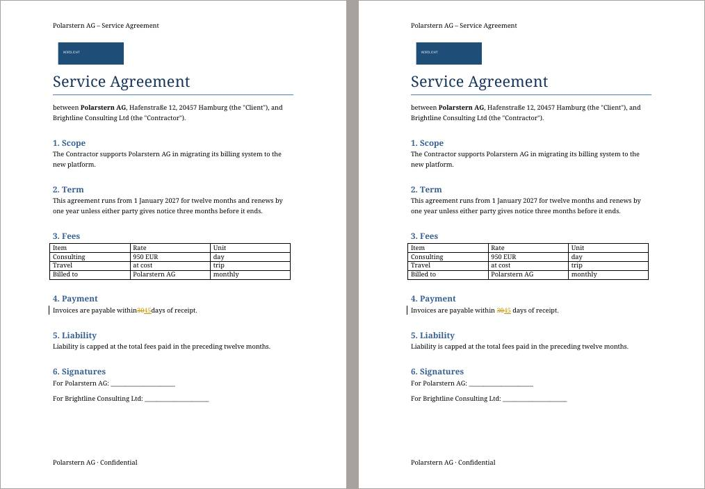
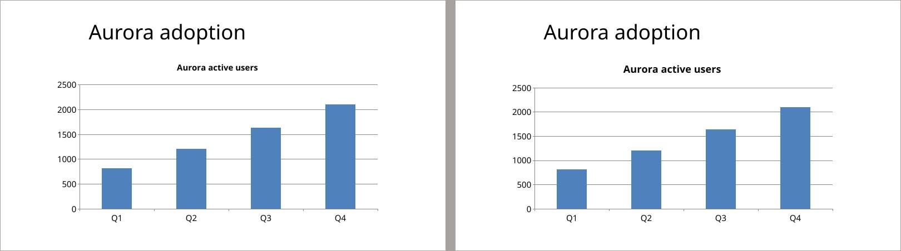

# Do the docx and powerpoint skills help Qwen3.8 27B with Word and PowerPoint?

*A/B test report · office-skills-27b · 2026-10-29*

**Of 6 tasks, No skills was better in 2, Skills in 1, and 3 showed no real difference.**

> **In short.** Two versions of konrad, No skills (main, without the docx and powerpoint skills) and Skills (with the docx and powerpoint skills from hermes-agent, plus the layout repair from 2026-10-28), did the same 6 tasks, 5 times each, with the same AI model. Every result was checked automatically for hard facts, and every pair of results was compared by AI reviewers who didn't know which version made which.

| task | outcome | pairs: No skills better / no difference / Skills better | checks passed No skills / Skills | tokens read No skills / Skills (k) |
| --- | --- | --- | --- | --- |
| [docx-edit-contract](#31-docx-edit-contract-skills-somewhat-better) | Skills somewhat better | 1 / 1 / 3 | 100% / 100% | 1282 / 726 |
| [pptx-create-deck](#32-pptx-create-deck-no-skills-somewhat-better) | No skills somewhat better | 6 / 2 / 2 | 95% / 100% | 848 / 370 |
| [pptx-edit-deck](#33-pptx-edit-deck-no-skills-clearly-better) | No skills clearly better | 3 / 2 / 0 | 100% / 98% | 1231 / 727 |
| [docx-create-report](#34-docx-create-report-no-real-difference) | no real difference | 1 / 3 / 1 | 100% / 100% | 282 / 355 |
| [docx-review-revisions](#35-docx-review-revisions-no-real-difference) | no real difference | 1 / 4 / 0 | 100% / 80% | 464 / 330 |
| [pptx-duplicate-cards](#36-pptx-duplicate-cards-no-real-difference) | no real difference | 0 / 4 / 1 | 80% / 100% | 790 / 535 |

## 1. What was compared

| | No skills | Skills |
| --- | --- | --- |
| version | main, without the docx and powerpoint skills | with the docx and powerpoint skills from hermes-agent, plus the layout repair from 2026-10-28 |
| image | `konrad:ab-noskills` | `konrad:ab-skills` |

Both versions ran with `openrouter/qwen/qwen3.8-27b (default effort)`. Each request ended with: “If one of your skills covers this file type, load it with the skill tool before you start, and follow it.” The tasks:

- **docx-edit-contract**: “Our client Nordlicht GmbH is now called Polarstern AG.”
- **pptx-create-deck**: “Make a 16:9 deck quarterly-review.pptx for Friday's sales meeting, five slides in this order.”
- **pptx-edit-deck**: “In deck.pptx, our product Alpha has been renamed Aurora: rename it everywhere in the deck, speaker notes and the chart included.”
- **docx-create-report**: “Write our Q3 project status report as status-report.docx, A4.”
- **docx-review-revisions**: “review.docx has tracked changes from two reviewers.”
- **pptx-duplicate-cards**: “team.pptx has a profile card on slide 2.”

## 2. How

1. **Same task, same input, 5 runs per version.** Run 1 of No skills and run 1 of Skills form a *pair*, and so on.
1. **Automatic checks.** Each task has a small test that checks fixed facts about the result (is the old name gone, is the chart there). They tell whether a result is correct, not whether it is good.
1. **Blind review.** An AI reviewer (Opus, as the ab-judge agent) gets the request, the input and both results as page images and text, labelled only “X” and “Y” in random order. It scores both on *request* (did it do what was asked), *fidelity* (is the data right) and *presentation* (could you hand it on as it is), and says which it would rather receive, or that it makes no difference.
1. **Each pair is reviewed twice,** by different reviewers, with X and Y swapped. A pair counts as a win only if both reviews pick the same version, otherwise as no difference. Here they agreed in 32 of 35 pairs.
1. **A task's outcome** is “clearly better” when one version wins at least half of all pairs more than the other, “somewhat better” when it wins at least two more, and “no real difference” otherwise.

## 3. Results

Per task: the outcome, what a reviewer saw, and where one version won, the pages that show it (No skills left, Skills right). All numbers and more reasons are folded away under each task.

### 3.1 docx-edit-contract: Skills somewhat better

*“Our client Nordlicht GmbH is now called Polarstern AG.”*

No skills better in 1 pairs, no difference in 1, Skills better in 3; the two reviews agreed in 4 of 5. Automatic checks passed: No skills 100%, Skills 100%.

**A reviewer on run 4:** Both rename every instance to Polarstern AG, including the body, the table, the header and the footer, and both add the comment. But No skills's tracked change in clause 4 dropped the spaces around the number. Page 1 and the text read 'within3045days', so once the change is accepted the clause reads 'within45days'. Skills keeps 'within 30→45 days' correctly spaced. No skills also credits the comment to 'Counsel for Polarstern AG', which misattributes it to the other side's lawyer. Skills's 'Brightline Consulting' fits the user's side.

*Run 4, contract-v2.docx, page 1: No skills left, Skills right.*

All numbers

| | No skills | Skills |
| --- | --- | --- |
| automatic checks passed | 100% (5 of 5 runs flawless) | 100% (5 of 5 runs flawless) |
| review score: request | 4.9 / 5 | 4.8 / 5 |
| review score: fidelity | 4.2 / 5 | 5.0 / 5 |
| review score: presentation | 4.5 / 5 | 4.6 / 5 |
| time per run | 471 s | 192 s |
| tokens read / written per run | 1282k / 47.2k | 726k / 15.3k |
| cost per run | $0.0675 | $0.0242 |
| runs that used a skill | 0 of 5 | 5 of 5 |

More reviewers' reasons

- **Run 5, No skills better:** Both rename every text instance to Polarstern AG, including the body, the table, the header and the footer. Both track 30→45 in clause 4 cleanly and add the comment. No skills also replaced the 'NORDLICHT' label in the logo banner at the top of page 1 with 'POLARSTERN' in the same style, so the old name truly appears nowhere. Skills leaves the old name in the logo. On the other side, Skills's comment author 'Brightline Consulting' fits the user's side, while No skills's 'Konrad' is a tool name.
- **Run 1, no difference:** Both outputs are the same on page 1. Every Nordlicht GmbH is now Polarstern AG, including the body, the table, the header and the footer. Clause 4 shows 30→45 as one tracked deletion and one insertion, the comment text is right, and the rest is untouched. The only difference is the comment author: No skills uses 'Brightline Consulting Ltd', which fits the user's side. Skills uses 'Agent', which is odd for a comment the client's lawyer will read.
- **Run 2, Skills better:** On page 1 both rename every instance to Polarstern AG, including the body, the table, the header and the footer. Both track 30→45 in clause 4 as one deletion and one insertion, add the comment text and leave the rest unchanged. They differ only in the comment author. No skills credits the comment to 'Polarstern AG', the client being asked to confirm, which misattributes it. Skills uses the tool name 'Konrad', which is unpolished but not misleading.

### 3.2 pptx-create-deck: No skills somewhat better

*“Make a 16:9 deck quarterly-review.pptx for Friday's sales meeting, five slides in this order.”*

No skills better in 6 pairs, no difference in 2, Skills better in 2; the two reviews agreed in 8 of 10. Automatic checks passed: No skills 95%, Skills 100%.

**A reviewer on run 1:** Both have the right content, a real clustered chart with the correct values and the full accounts table. Skills's placeholders are still sized for 4:3 (9 in wide) on the 16:9 slide, so titles sit off-centre on every slide (slides 1-5), and slides 3 and 4 still carry empty content placeholders behind the chart and table. Skills's slide 3 note also says East had 'the biggest jump', but West grew more (+68, +20.6%). No skills is centred and clean, with accurate notes.

*Run 1, quarterly-review.pptx, slide 1: No skills left, Skills right.*

All numbers

| | No skills | Skills |
| --- | --- | --- |
| automatic checks passed | 95% (9 of 10 runs flawless) | 100% (10 of 10 runs flawless) |
| review score: request | 4.8 / 5 | 4.5 / 5 |
| review score: fidelity | 4.6 / 5 | 4.5 / 5 |
| review score: presentation | 4.0 / 5 | 3.5 / 5 |
| time per run | 168 s | 88 s |
| tokens read / written per run | 848k / 21.8k | 370k / 9.2k |
| cost per run | $0.0318 | $0.0142 |
| runs that used a skill | 1 of 10 | 10 of 10 |

More reviewers' reasons

- **Run 7, Skills better:** No skills builds every slide on the Blank layout with loose text boxes, so there is no real title slide and the slides have no titles in the outline. Its Highlights and Next steps items (slides 2 and 5) have no bullet markers, the body text is small, and the slide 1 title sits slightly off-centre. Skills uses real Title Slide and Title and Content layouts with bulleted lists and centred titles. Skills's weaknesses are a tiny legend on slide 3 and empty content placeholders left behind the chart and table on slides 3-4.
- **Run 6, no difference:** Each has a comparable flaw. No skills's titles sit off-centre on every slide (4:3-sized placeholders), and its slide 4 note wrongly says West has two of the top five accounts; it has one. Skills's titles are centred and its notes are accurate. However, Skills's slide 3 chart has no Q2/Q3 legend, and both its chart and table (slides 3-4) hug the left, leaving the right third empty. No skills's chart is full-width with a legend.
- **Run 2, No skills better:** Both decks have the right text, the correct chart values and the full accounts table. Skills's slide 3 chart has no legend, so the audience can't tell which bar is Q2 and which is Q3. Skills's titles also sit off-centre on every slide because its placeholders are still 4:3-sized on the 16:9 page. No skills is centred and has a legend; its only slip is the slide 4 note claiming the five accounts 'drive most of our Q3 revenue' (634 of 1556 kEUR).

### 3.3 pptx-edit-deck: No skills clearly better

*“In deck.pptx, our product Alpha has been renamed Aurora: rename it everywhere in the deck, speaker notes and the chart included.”*

No skills better in 3 pairs, no difference in 2, Skills better in 0; the two reviews agreed in 5 of 5. Automatic checks passed: No skills 100%, Skills 98%.

**A reviewer on run 4:** Both make every requested change: Aurora in the slides, notes and chart, Q3=1640, Q4=2100 added, Old roadmap deleted and Summary moved to slide 5. Both also leave the input unchanged. On slide 3, Skills renders the chart title 'Aurora active users' in a visibly larger font than the original, which shrinks the plot a little. No skills keeps the original title size, as 'leave everything else as it is' asks. Slides 1, 2, 4 and 5 are identical.

*Run 4, deck-v2.pptx, slide 3: No skills left, Skills right.*

All numbers

| | No skills | Skills |
| --- | --- | --- |
| automatic checks passed | 100% (5 of 5 runs flawless) | 98% (4 of 5 runs flawless) |
| review score: request | 5.0 / 5 | 4.7 / 5 |
| review score: fidelity | 5.0 / 5 | 4.8 / 5 |
| review score: presentation | 5.0 / 5 | 4.6 / 5 |
| time per run | 230 s | 157 s |
| tokens read / written per run | 1231k / 25.1k | 727k / 20.0k |
| cost per run | $0.0383 | $0.0292 |
| runs that used a skill | 0 of 5 | 5 of 5 |

More reviewers' reasons

- **Run 1, No skills better:** The two deck-v2.pptx files are equivalent: Aurora everywhere including notes and the chart title, Q3=1640, Q4=2100 added, Old roadmap gone, Summary last on slide 5. Skills, however, overwrote the user's original deck.pptx with a half-edited 5-slide version (its chart title still reads 'Alpha active users'), destroying the input despite 'leave everything else as it is'; No skills left deck.pptx unchanged. Skills's chart title on slide 3 also renders at a larger font than the original, while No skills keeps the original title size.
- **Run 2, no difference:** Both deck-v2.pptx files are the same size, with identical outlines, text, notes and renders. Alpha is renamed Aurora on every slide, in the notes and in the chart title (slide 3). The chart shows Q3=1640 and adds Q4=2100. Old roadmap is deleted and Summary is now slide 5. Both left the input deck.pptx unchanged, so there is no difference that matters.
- **Run 5, No skills better:** Both make every requested change: Aurora in the slides, notes and chart, Q3=1640, Q4=2100 added, Old roadmap deleted and Summary moved to slide 5. Both also leave the input unchanged. On slide 3, Skills renders the chart title 'Aurora active users' in a visibly larger font than the original. No skills keeps the original title size, as 'leave everything else as it is' asks. Slides 1, 2, 4 and 5 are identical.

### 3.4 docx-create-report: no real difference

*“Write our Q3 project status report as status-report.docx, A4.”*

No skills better in 1 pairs, no difference in 3, Skills better in 1; the two reviews agreed in 5 of 5. Automatic checks passed: No skills 100%, Skills 100%.

**A reviewer on run 2:** Both deliver everything that was asked on page 1: A4, Title style, four Heading 1 sections in order, all six milestone rows with Ü/Ö/ß intact, a bold header row, bullet and numbered lists, and a PAGE/NUMPAGES footer. The only differences are style and wording. No skills centres the title and footer while Skills aligns them left, and the one-sentence summaries are equivalent. No skills adds 'most milestones are on track', which is a fair reading of the table.

All numbers

| | No skills | Skills |
| --- | --- | --- |
| automatic checks passed | 100% (5 of 5 runs flawless) | 100% (5 of 5 runs flawless) |
| review score: request | 5.0 / 5 | 5.0 / 5 |
| review score: fidelity | 4.6 / 5 | 4.8 / 5 |
| review score: presentation | 5.0 / 5 | 5.0 / 5 |
| time per run | 79 s | 77 s |
| tokens read / written per run | 282k / 7.5k | 355k / 6.9k |
| cost per run | $0.0118 | $0.0109 |
| runs that used a skill | 0 of 5 | 5 of 5 |

More reviewers' reasons

- **Run 1, No skills better:** Both documents on page 1 are almost identical: A4, Title style, four Heading 1 sections in order, all six milestone rows with Ü/Ö/ß intact, a bold header row, bullet and numbered lists, and a PAGE/NUMPAGES footer. No skills's summary is the short paragraph that was asked for. Skills's is three sentences and adds a claim the CSV doesn't support ('all pilot milestones were delivered on time'). Skills's footer does store cached field values, but that makes no visible difference.
- **Run 5, Skills better:** Layout and structure match on page 1: A4, Title style, four Heading 1 sections in order, all six rows with Ü/Ö/ß intact, a bold header row, bullet and numbered lists, and a PAGE/NUMPAGES footer. Skills's summary is one short sentence and every point in it comes from the brief. No skills's summary invents facts the user never gave: 'both branches completed on schedule' and 'early feedback is positive'. It also runs past the short paragraph that was asked for, so the user would have to correct it before handing it on.
- **Run 3, no difference:** Both match the request in full on page 1: A4, Title style, Heading 1 sections in the right order, all six milestone rows with Ü/Ö/ß intact, a bold header row, bullet and numbered lists, and a 'Page 1 of 1' field footer. Skills's summary has two sentences and also names the completed sign-off and review, while No skills's is a single sentence. Both are short and accurate against the CSV. No skills's centred footer against Skills's left-aligned one is the only other visible difference, and neither change matters to the user.

### 3.5 docx-review-revisions: no real difference

*“review.docx has tracked changes from two reviewers.”*

No skills better in 1 pairs, no difference in 4, Skills better in 0; the two reviews agreed in 5 of 5. Automatic checks passed: No skills 100%, Skills 80%.

**A reviewer on run 1:** Both review-final.docx files read identically on page 1: Anna Berg's changes accepted (five, 23, Rollout, 15 November), Ben Ott's rejected (no 'very', 'with few complaints' kept, no 'overall', 'is planned for', no '(TBD)'), with no tracked changes left and all three comments kept. Both comments.txt files are the same three 'Author: text' lines with the en dash intact. Neither leaves any extra files behind.

All numbers

| | No skills | Skills |
| --- | --- | --- |
| automatic checks passed | 100% (5 of 5 runs flawless) | 80% (4 of 5 runs flawless) |
| review score: request | 5.0 / 5 | 4.2 / 5 |
| review score: fidelity | 5.0 / 5 | 4.2 / 5 |
| review score: presentation | 5.0 / 5 | 4.2 / 5 |
| time per run | 160 s | 86 s |
| tokens read / written per run | 464k / 14.9k | 330k / 6.3k |
| cost per run | $0.0211 | $0.0097 |
| runs that used a skill | 0 of 5 | 5 of 5 |

More reviewers' reasons

- **Run 3, No skills better:** Skills delivered nothing: neither review-final.docx nor comments.txt exists, and its workspace holds only the unchanged input. No skills's review-final.docx (page 1) accepts Anna Berg's edits (five, 23, Rollout, 15 November) and rejects Ben Ott's, with no tracked changes left and all three comments kept. Its comments.txt lists the three comments correctly as 'Author: text'.
- **Run 2, no difference:** Both deliver the same review-final.docx on page 1: Anna Berg's edits accepted (five, 23, Rollout, 15 November), Ben Ott's rejected ('very', 'overall', 'will slip to' and '(TBD)' dropped, 'with few complaints' and 'is planned for' restored), with no tracked changes left and all three comments kept. The comments.txt files are identical and correct, en dash included. Neither leaves extra files.
- **Run 4, no difference:** Both review-final.docx files are the same on page 1: Anna Berg's edits accepted (five, 23, Rollout, 15 November), Ben Ott's rejected ('very', 'overall', 'will slip to' and '(TBD)' gone, 'with few complaints' and 'is planned for' kept), no tracked changes left, and all three comments still anchored. The comments.txt files are identical and correct, en dash intact. Neither leaves leftover files.

### 3.6 pptx-duplicate-cards: no real difference

*“team.pptx has a profile card on slide 2.”*

No skills better in 0 pairs, no difference in 4, Skills better in 1; the two reviews agreed in 5 of 5. Automatic checks passed: No skills 80%, Skills 100%.

**A reviewer on run 1:** Both decks are the same: the title slide, then four cards (slides 2-5) in CSV order with the photo, layout and role styling kept, the umlauts and ø/ı right, notes 'Intro: <name>', the template removed, and slide-number fields on slides 2-5 only. The only difference is the field's cached text: Skills stores '‹#›' and No skills stores the real number. Both render 2-5 correctly. In both decks the number sits a little left of the bottom-right corner, so it looks slightly off-corner.

All numbers

| | No skills | Skills |
| --- | --- | --- |
| automatic checks passed | 80% (4 of 5 runs flawless) | 100% (5 of 5 runs flawless) |
| review score: request | 4.2 / 5 | 5.0 / 5 |
| review score: fidelity | 4.2 / 5 | 5.0 / 5 |
| review score: presentation | 3.4 / 5 | 4.0 / 5 |
| time per run | 358 s | 156 s |
| tokens read / written per run | 790k / 31.7k | 535k / 11.3k |
| cost per run | $0.0465 | $0.0178 |
| runs that used a skill | 0 of 5 | 5 of 5 |

More reviewers' reasons

- **Run 4, Skills better:** No skills delivered no team-v2.pptx: its workspace holds only the untouched inputs. Skills has the title slide, then four cards (slides 2-5) in CSV order with the photo and styling kept. Its names (Jörg, Amélie, Søren, Aydın), roles and notes 'Intro: <name>' are correct, the template is gone, and slide numbers are on slides 2-5 only.
- **Run 2, no difference:** No skills and Skills match slide for slide. Both have the title slide, then four cards (slides 2-5) in CSV order with the photo and role styling kept. The names (Jörg, Amélie, Søren, Aydın) and notes 'Intro: <name>' are correct, the template card is gone, and slide-number fields are on slides 2-5 only. Nothing differs that a user would notice; in both decks the number sits slightly left of the bottom-right corner.
- **Run 3, no difference:** Both decks look the same: four cards on slides 2-5 in CSV order, copied from the template with the photo, title and role styling kept. The names and roles are correct, special characters included, the notes read 'Intro: <name>', the template is gone, and slide-number fields are on slides 2-5 only. The one internal difference is that No skills caches the real number in the field and Skills caches '‹#›'. Both render correctly, so the difference doesn't matter to the user.

## 4. Compared with Haiku

The [same test with Haiku 5.5](../2026-10-28-office-skills/) (10 runs per task, judged by Sonnet) came out like this:

| task | Haiku: no skills better / no difference / skills better | Qwen 27B: No skills better / no difference / Skills better |
| --- | --- | --- |
| pptx-create-deck | 10 / 0 / 0 | 6 / 2 / 2 |
| pptx-edit-deck | 5 / 5 / 0 | 3 / 2 / 0 |
| docx-create-report | 0 / 9 / 1 | 1 / 3 / 1 |
| docx-edit-contract | 0 / 9 / 1 | 1 / 1 / 3 |
| docx-review-revisions | 0 / 10 / 0 | 1 / 4 / 0 |
| pptx-duplicate-cards | 0 / 10 / 0 | 0 / 4 / 1 |

- **The decks lose with both models.** Creating a deck, the skill's script draws its chart without a legend (4 of 10 runs), in some runs leaves empty content placeholders behind the chart and table, and in 2 of 10 runs 27B skipped the layout repair, so the titles sat off-centre. Without the skill, 27B made its own mistakes: titles off-centre in 3 of 10 runs and, once, every slide on the Blank layout with no real titles. So the margin is smaller than with Haiku, whose decks without the skill won all 10 pairs. Editing a deck, the skill's replace script enlarges the chart title it renames, as it did for Haiku, and in one run 27B overwrote the user's `deck.pptx` along the way.
- **The one task the skills won is thin.** On the contract, the documents matched; the reviewers preferred the skills side for its comment author (it named the user's side, where the other named the client or the client's lawyer) and once for a tracked change without a lost space.
- **The other three tasks tie,** as they did with Haiku.
- **Cost points the other way.** With Haiku, the skills cost 5-60% more tokens. With 27B they halve the work: about 17 steps instead of 22, 120 s instead of 234 s and 490k tokens read instead of 820k per run, because a ready script replaces the code 27B otherwise writes and debugs itself.

**Conclusion:** the skills don't make 27B's Word or PowerPoint files better either, and they still make its decks worse, so taking them out (2026-10-28) holds for the smaller model too. What they show is that a small model gains speed from ready scripts: a deck and document helper without these flaws would keep that gain.

## 5. What else the runs showed

- **Two runs delivered nothing,** one per side, for reasons outside the skills: with the skills, one docx-review-revisions run stopped after two steps and 20 seconds; without, one pptx-duplicate-cards run was still working at the 15-minute limit. One docx-edit-contract run without the skills also hit the limit, after delivering a correct file.
- **Language.** In one deck run with the skills, 27B wrote all speaker notes in Spanish for an English deck.
- **Cost.** opencode's estimate for the 70 runs: $1.24 without the skills, $0.60 with them. The judging (70 packets, Opus) cost about $13.70.
- **The reviewers agreed with themselves in 32 of 35 pairs,** more often than the Sonnet reviewers of the earlier reports (46 of 60, 72 of 85).

## 6. Limits

- pptx-create-deck ran 10 times per version and the other tasks 5 times, to keep the cost down; 5 pairs show clear differences, not subtle ones.
- The reviewers are AI models. They agreed with themselves as shown above, but nobody checked every verdict by hand.
- The runs used `openrouter/qwen/qwen3.8-27b (default effort)`; another model, such as the local one konrad is tuned for, may behave differently.
- Each reviewer could open only its own batch's folder, so the other packets and the runs' files stayed out of its reach. A first judging pass went wrong (a launcher bug handed the reviewers a bare path); it wrote no verdicts, and the packets were rebuilt under new names before this one.
- The Haiku report was judged by Sonnet, this one by Opus: each report's verdicts are consistent within it, but the two reviewers may weigh things differently.
