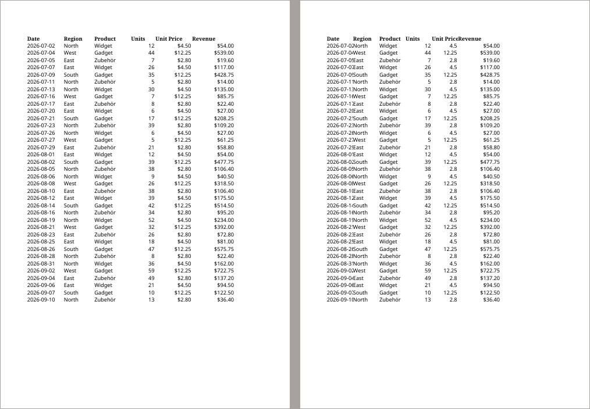
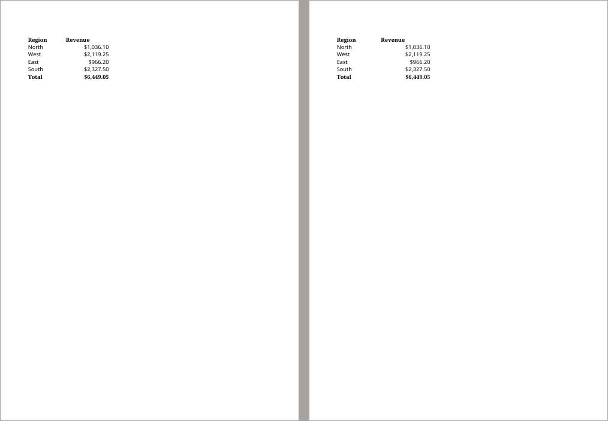
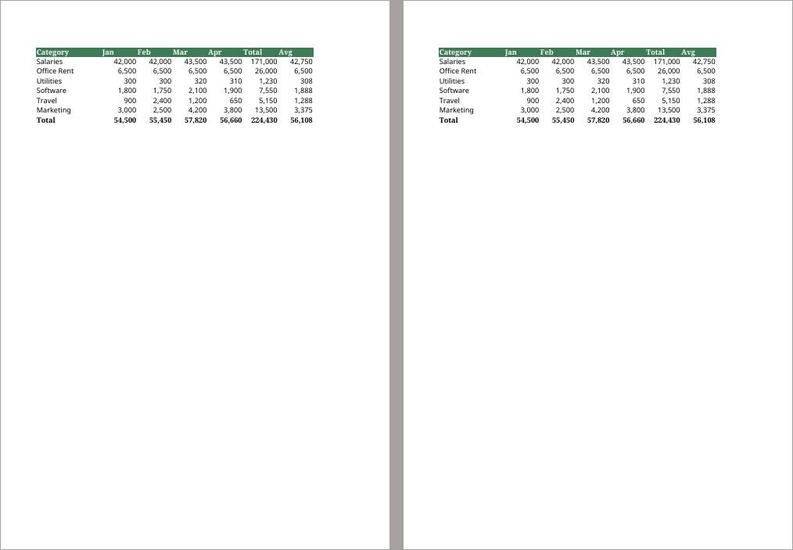
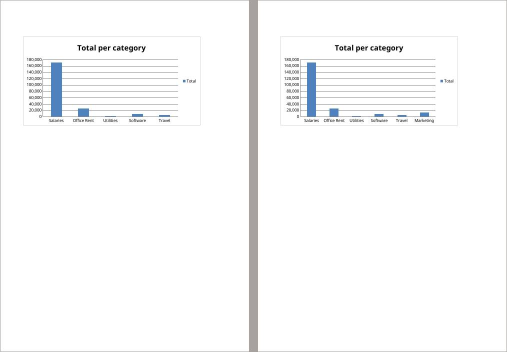

# Does hermes-agent's xlsx skill do better than no spreadsheet skill?

*A/B test report · xlsx-vs-noskill · 2026-10-29*

**Of 3 tasks, No skill was better in 1, xlsx in 1, and 1 showed no real difference.**

> **In short.** Two versions of konrad, No skill (main without any spreadsheet skill or spreadsheet checklist) and xlsx (main, with hermes-agent's xlsx skill), did the same 3 tasks, 10 times each, with the same AI model. Every result was checked automatically for hard facts, and every pair of results was compared by AI reviewers who didn't know which version made which.

| task | outcome | pairs: No skill better / no difference / xlsx better | checks passed No skill / xlsx | tokens read No skill / xlsx (k) |
| --- | --- | --- | --- | --- |
| [xlsx-create-report](#31-xlsx-create-report-no-skill-somewhat-better) | No skill somewhat better | 5 / 3 / 2 | 100% / 100% | 154 / 283 |
| [xlsx-edit-budget](#32-xlsx-edit-budget-xlsx-clearly-better) | xlsx clearly better | 0 / 4 / 6 | 94% / 97% | 134 / 321 |
| [xlsx-csv-locale](#33-xlsx-csv-locale-no-real-difference) | no real difference | 1 / 9 / 0 | 100% / 100% | 199 / 263 |

## 1. What was compared

| | No skill | xlsx |
| --- | --- | --- |
| version | main without any spreadsheet skill or spreadsheet checklist | main, with hermes-agent's xlsx skill |
| image | `konrad:ab-noskill` | `konrad:ab-xlsx` |

Both versions ran with `anthropic/claude-haiku-5-5 (low effort)`. Each request ended with: “If one of your skills covers this file type, load it with the skill tool before you start, and follow it.” The tasks:

- **xlsx-create-report**: “sales.csv holds this quarter's sales.”
- **xlsx-edit-budget**: “budget.xlsx is our department budget.”
- **xlsx-csv-locale**: “export.csv is an export from our German accounting tool.”

## 2. How

1. **Same task, same input, 10 runs per version.** Run 1 of No skill and run 1 of xlsx form a *pair*, and so on.
1. **Automatic checks.** Each task has a small test that checks fixed facts about the result (is the old name gone, is the chart there). They tell whether a result is correct, not whether it is good.
1. **Blind review.** An AI reviewer (Sonnet, as the ab-judge agent) gets the request, the input and both results as page images and text, labelled only “X” and “Y” in random order. It scores both on *request* (did it do what was asked), *fidelity* (is the data right) and *presentation* (could you hand it on as it is), and says which it would rather receive, or that it makes no difference.
1. **Each pair is reviewed twice,** by different reviewers, with X and Y swapped. A pair counts as a win only if both reviews pick the same version, otherwise as no difference. Here they agreed in 26 of 30 pairs.
1. **A task's outcome** is “clearly better” when one version wins at least half of all pairs more than the other, “somewhat better” when it wins at least two more, and “no real difference” otherwise.

## 3. Results

Per task: the outcome, what a reviewer saw, and where one version won, the pages that show it (No skill left, xlsx right). All numbers and more reasons are folded away under each task.

### 3.1 xlsx-create-report: No skill somewhat better

*“sales.csv holds this quarter's sales.”*

No skill better in 5 pairs, no difference in 3, xlsx better in 2; the two reviews agreed in 7 of 10. Automatic checks passed: No skill 100%, xlsx 100%.

**A reviewer on run 3:** Formulas and totals are identical ($6,449.05). xlsx has a too-narrow Date column that cuts off dates, Unit Price shown as plain 4.5 / 12.25 without currency format, and crowded headers. No skill has legible widths and consistent $ formatting on both price and revenue.

*Run 3, report.xlsx, page 1: No skill left, xlsx right.*

*Run 3, report.xlsx, page 2: No skill left, xlsx right.*

All numbers

| | No skill | xlsx |
| --- | --- | --- |
| automatic checks passed | 100% (10 of 10 runs flawless) | 100% (10 of 10 runs flawless) |
| review score: request | 5.0 / 5 | 5.0 / 5 |
| review score: fidelity | 5.0 / 5 | 5.0 / 5 |
| review score: presentation | 4.0 / 5 | 3.6 / 5 |
| time per run | 26 s | 35 s |
| tokens read / written per run | 154k / 3.7k | 283k / 4.1k |
| cost per run | $0.0044 | $0.0068 |
| runs that used a skill | 0 of 10 | 10 of 10 |

More reviewers' reasons

- **Run 2, xlsx better:** Both deliver the same values and totals ($6,449.05) with currency format and bold headers. In No skill the Date column is too narrow, so dates are cut off on page 1 (2026-07-0, etc.) and Unit Price/Revenue headers run together. xlsx has readable column widths throughout and looks finished.
- **Run 1, no difference:** Both have correct formulas, SUMIF summary, total of $6,449.05 and bold headers with currency formats. xlsx stores real dates and keeps the sheet compact on two pages with tidy widths; No skill keeps dates as text and has a long header 'Revenue (Units × Unit Price)' that makes the Data sheet spill across three pages. No skill sorts regions alphabetically, xlsx in order of appearance; neither matters much.
- **Run 5, xlsx better:** Both have correct formulas and the $6,449.05 total. No skill's Date column is too narrow so dates are cut off, and its Unit Price header runs into the long 'Revenue (Units × Unit Price)' header on page 1, which is also repeated oddly on the Summary sheet. xlsx has readable widths and a clean 'Revenue' header, though its Date column is indented against a left-aligned header.

### 3.2 xlsx-edit-budget: xlsx clearly better

*“budget.xlsx is our department budget.”*

No skill better in 0 pairs, no difference in 4, xlsx better in 6; the two reviews agreed in 9 of 10. Automatic checks passed: No skill 94%, xlsx 97%.

**A reviewer on run 2:** Table data, formulas and formatting are identical. xlsx extended the existing chart so Marketing still appears (page 2 shows six categories); No skill's chart stops at Travel, silently losing Marketing.

*Run 2, budget-updated.xlsx, page 1: No skill left, xlsx right.*

*Run 2, budget-updated.xlsx, page 2: No skill left, xlsx right.*

All numbers

| | No skill | xlsx |
| --- | --- | --- |
| automatic checks passed | 94% (0 of 10 runs flawless) | 97% (5 of 10 runs flawless) |
| review score: request | 4.0 / 5 | 4.5 / 5 |
| review score: fidelity | 3.5 / 5 | 4.2 / 5 |
| review score: presentation | 3.6 / 5 | 4.2 / 5 |
| time per run | 23 s | 39 s |
| tokens read / written per run | 134k / 3.7k | 321k / 6.4k |
| cost per run | $0.0039 | $0.0085 |
| runs that used a skill | 0 of 10 | 10 of 10 |

More reviewers' reasons

- **Run 4, no difference:** Identical tables, formulas and formatting; both charts omit Marketing after the insert. No difference that matters.
- **Run 3, xlsx better:** Table content is equivalent in both (Utilities row, totals, Avg formulas). xlsx's chart on page 2 was extended to include Marketing; No skill's chart stops at Travel, dropping a category from the existing chart.
- **Run 6, xlsx better:** Rows, totals and Avg formulas are correct in both. xlsx's chart covers all six categories including Marketing; No skill's chart ends at Travel and loses Marketing.

### 3.3 xlsx-csv-locale: no real difference

*“export.csv is an export from our German accounting tool.”*

No skill better in 1 pairs, no difference in 9, xlsx better in 0; the two reviews agreed in 10 of 10. Automatic checks passed: No skill 100%, xlsx 100%.

**A reviewer on run 1:** Both hold the same 24 rows with real dates, numeric amounts and rates, and =SUM(C2:C25). They differ only in where the Summe label sits (A in No skill, B in xlsx).

All numbers

| | No skill | xlsx |
| --- | --- | --- |
| automatic checks passed | 100% (10 of 10 runs flawless) | 100% (10 of 10 runs flawless) |
| review score: request | 5.0 / 5 | 5.0 / 5 |
| review score: fidelity | 5.0 / 5 | 5.0 / 5 |
| review score: presentation | 4.0 / 5 | 3.9 / 5 |
| time per run | 41 s | 31 s |
| tokens read / written per run | 199k / 3.8k | 263k / 4.0k |
| cost per run | $0.0047 | $0.0063 |
| runs that used a skill | 0 of 10 | 10 of 10 |

More reviewers' reasons

- **Run 9, No skill better:** Both have correct data and the SUM formula. No skill keeps the German dd.mm.yyyy date display of the source, while xlsx shows ISO yyyy-mm-dd dates, which is less natural for a German accounting file.
- **Run 2, no difference:** Data, formats and the SUM formula are identical in both, with Summe in column A. Only the Betrag column width differs slightly.
- **Run 3, no difference:** Identical data, real dates, numeric values and SUM formula. Only the Summe label position (B in xlsx, A in No skill) and column widths differ, which does not matter.

## 4. Limits

- 10 pairs per task show clear differences, not subtle ones.
- The reviewers are AI models. They agreed with themselves as shown above, but nobody checked every verdict by hand.
- The runs used `anthropic/claude-haiku-5-5 (low effort)`; another model, such as the local one konrad is tuned for, may behave differently.
- Each reviewer could open only its own batch's folder, so the other packets and the runs' files stayed out of its reach.
- The two xlsx reports of 2026-10-29 ran the xlsx side separately, ten times each, so their xlsx numbers differ by the spread between runs (the chart in xlsx-edit-budget kept its range in 2 of 10 runs in one and 5 of 10 in the other).
- The page renders don't show frozen panes, so the reviewers couldn't judge the frozen header in xlsx-create-report; the automatic checks cover it.
- The prompt suffix made Haiku load the skill in every run, so this measures the skill's content, not what a user sees: unprompted, Haiku loads a spreadsheet skill in 0–2 of 10 runs, while Qwen3.8 27B loads it every time ([models report](../2026-10-29-models/)).
