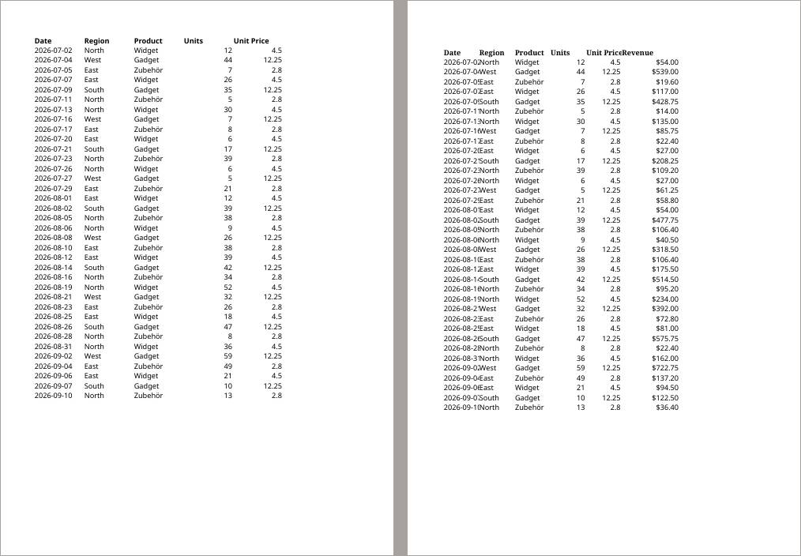
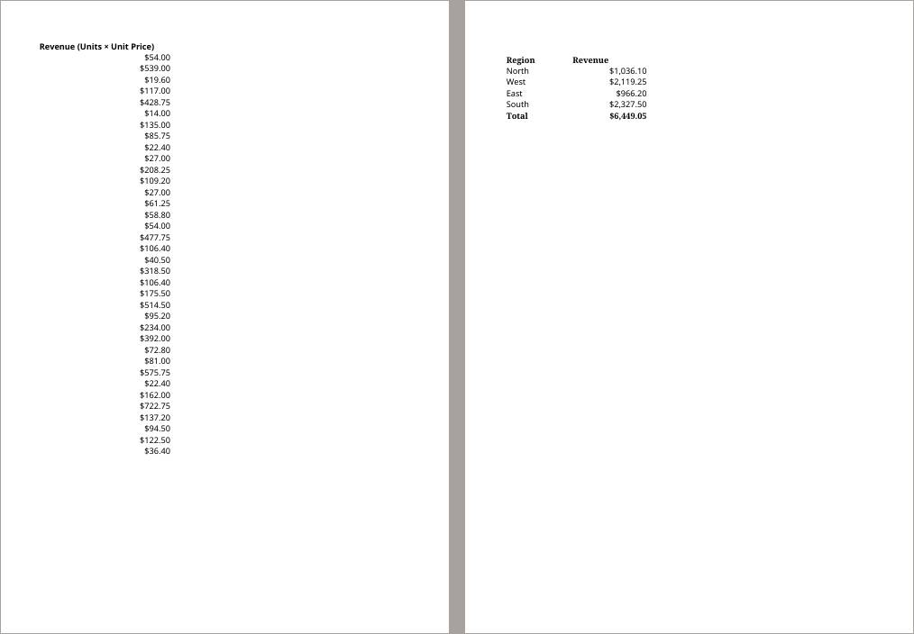
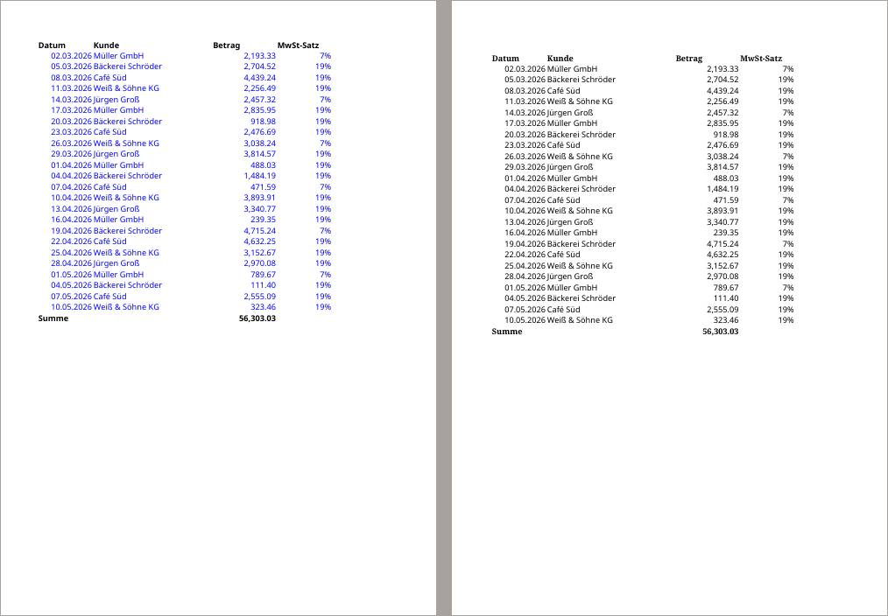
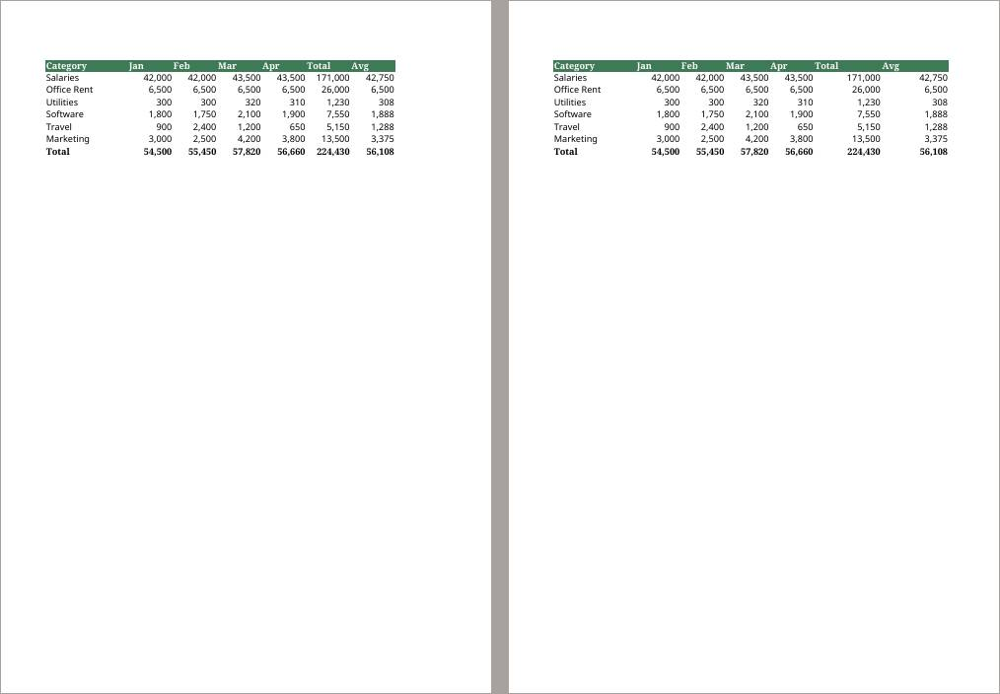
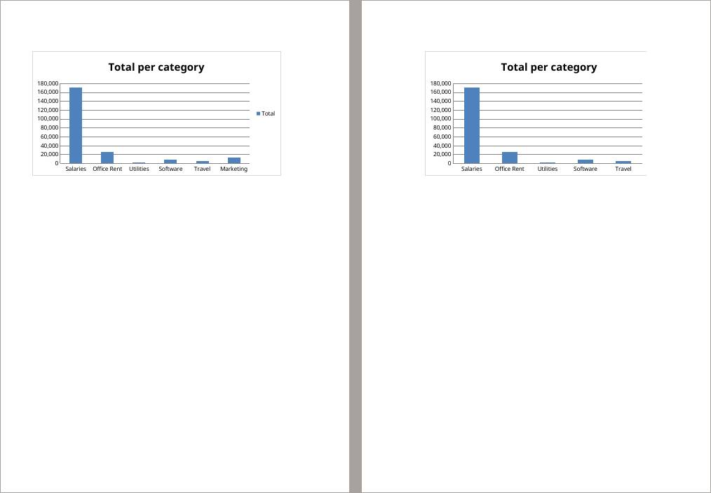

# Does hermes-agent's xlsx skill do better than konrad's own spreadsheets skill?

*A/B test report · xlsx-vs-spreadsheets · 2026-10-29*

**Of 3 tasks, spreadsheets was better in 2, xlsx in 1, and 0 showed no real difference.**

> **In short.** Two versions of konrad, spreadsheets (main with the spreadsheets skill from before the swap back in place of xlsx) and xlsx (main, with hermes-agent's xlsx skill), did the same 3 tasks, 10 times each, with the same AI model. Every result was checked automatically for hard facts, and every pair of results was compared by AI reviewers who didn't know which version made which.

| task | outcome | pairs: spreadsheets better / no difference / xlsx better | checks passed spreadsheets / xlsx | tokens read spreadsheets / xlsx (k) |
| --- | --- | --- | --- | --- |
| [xlsx-create-report](#31-xlsx-create-report-spreadsheets-clearly-better) | spreadsheets clearly better | 7 / 2 / 1 | 91% / 100% | 659 / 289 |
| [xlsx-csv-locale](#32-xlsx-csv-locale-xlsx-somewhat-better) | xlsx somewhat better | 1 / 5 / 4 | 100% / 100% | 630 / 279 |
| [xlsx-edit-budget](#33-xlsx-edit-budget-spreadsheets-clearly-better) | spreadsheets clearly better | 8 / 2 / 0 | 98% / 95% | 334 / 246 |

## 1. What was compared

| | spreadsheets | xlsx |
| --- | --- | --- |
| version | main with the spreadsheets skill from before the swap back in place of xlsx | main, with hermes-agent's xlsx skill |
| image | `konrad:ab-spreadsheets` | `konrad:ab-xlsx` |

Both versions ran with `anthropic/claude-haiku-5-5 (low effort)`. Each request ended with: “If one of your skills covers this file type, load it with the skill tool before you start, and follow it.” The tasks:

- **xlsx-create-report**: “sales.csv holds this quarter's sales.”
- **xlsx-csv-locale**: “export.csv is an export from our German accounting tool.”
- **xlsx-edit-budget**: “budget.xlsx is our department budget.”

## 2. How

1. **Same task, same input, 10 runs per version.** Run 1 of spreadsheets and run 1 of xlsx form a *pair*, and so on.
1. **Automatic checks.** Each task has a small test that checks fixed facts about the result (is the old name gone, is the chart there). They tell whether a result is correct, not whether it is good.
1. **Blind review.** An AI reviewer (Sonnet, as the ab-judge agent) gets the request, the input and both results as page images and text, labelled only “X” and “Y” in random order. It scores both on *request* (did it do what was asked), *fidelity* (is the data right) and *presentation* (could you hand it on as it is), and says which it would rather receive, or that it makes no difference.
1. **Each pair is reviewed twice,** by different reviewers, with X and Y swapped. A pair counts as a win only if both reviews pick the same version, otherwise as no difference. Here they agreed in 27 of 30 pairs.
1. **A task's outcome** is “clearly better” when one version wins at least half of all pairs more than the other, “somewhat better” when it wins at least two more, and “no real difference” otherwise.

## 3. Results

Per task: the outcome, what a reviewer saw, and where one version won, the pages that show it (spreadsheets left, xlsx right). All numbers and more reasons are folded away under each task.

### 3.1 xlsx-create-report: spreadsheets clearly better

*“sales.csv holds this quarter's sales.”*

spreadsheets better in 7 pairs, no difference in 2, xlsx better in 1; the two reviews agreed in 8 of 10. Automatic checks passed: spreadsheets 91%, xlsx 100%.

**A reviewer on run 2:** Data and formulas are equivalent and correct in both. xlsx keeps default column widths, so the Date column is cut off (2026-07-0...) and runs into Region and the Unit Price and Revenue headers touch on page 1. spreadsheets has properly sized columns, nothing truncated, and a clean Summary.

*Run 2, report.xlsx, page 1: spreadsheets left, xlsx right.*

*Run 2, report.xlsx, page 2: spreadsheets left, xlsx right.*

All numbers

| | spreadsheets | xlsx |
| --- | --- | --- |
| automatic checks passed | 91% (9 of 10 runs flawless) | 100% (10 of 10 runs flawless) |
| review score: request | 5.0 / 5 | 4.9 / 5 |
| review score: fidelity | 5.0 / 5 | 5.0 / 5 |
| review score: presentation | 3.8 / 5 | 2.9 / 5 |
| time per run | 76 s | 38 s |
| tokens read / written per run | 659k / 10.9k | 289k / 4.4k |
| cost per run | $0.0171 | $0.0075 |
| runs that used a skill | 10 of 10 | 10 of 10 |

More reviewers' reasons

- **Run 4, xlsx better:** Both have correct formulas, currency formats and totals. spreadsheets leaves default column widths, so the dates are truncated and the Unit Price and Revenue headers collide on page 1. xlsx has proper widths and a readable Data sheet.
- **Run 1, no difference:** Both are correct: same formulas, totals of $6,449.05, bold headers, sensible column widths. xlsx formats Unit Price as currency too, so the Data sheet looks uniform. spreadsheets leaves Unit Price as plain 4.5 / 2.8 next to dollar Revenue and adds blue and green font colours nobody asked for.
- **Run 3, spreadsheets better:** Same data and totals in both. xlsx's default column widths truncate every date and squeeze the Unit Price and Revenue headers together on page 1. spreadsheets has readable widths and a clean layout, though its Unit Price column is not currency-formatted whereas xlsx's is.

### 3.2 xlsx-csv-locale: xlsx somewhat better

*“export.csv is an export from our German accounting tool.”*

spreadsheets better in 1 pairs, no difference in 5, xlsx better in 4; the two reviews agreed in 9 of 10. Automatic checks passed: spreadsheets 100%, xlsx 100%.

**A reviewer on run 1:** Data, real dates, numeric amounts and rates, and the =SUM(C2:C25) row are identical in both. spreadsheets colours every data cell blue, which looks like a financial-model input convention and is unrequested noise on a plain conversion; xlsx keeps black text with a bold header and Summe row.

*Run 1, export.xlsx, page 1: spreadsheets left, xlsx right.*

All numbers

| | spreadsheets | xlsx |
| --- | --- | --- |
| automatic checks passed | 100% (10 of 10 runs flawless) | 100% (10 of 10 runs flawless) |
| review score: request | 5.0 / 5 | 5.0 / 5 |
| review score: fidelity | 5.0 / 5 | 5.0 / 5 |
| review score: presentation | 3.6 / 5 | 4.0 / 5 |
| time per run | 57 s | 32 s |
| tokens read / written per run | 630k / 10.4k | 279k / 4.3k |
| cost per run | $0.0158 | $0.0068 |
| runs that used a skill | 10 of 10 | 10 of 10 |

More reviewers' reasons

- **Run 3, spreadsheets better:** Both carry identical data, real dates, numeric values and a SUM formula row. spreadsheets adds a thin rule above the total, which reads slightly more finished; otherwise the two are nearly the same.
- **Run 2, no difference:** Data and formula are identical. xlsx has a bold header row and a bold Summe label in column A; spreadsheets puts Summe in column B under Kunde and leaves the header unbolded, so it looks less finished.
- **Run 7, xlsx better:** Data and formula are identical. spreadsheets colours all data cells blue, an unrequested input-cell convention that makes a plain accounting export look odd; xlsx keeps black text with a bold header and total.

### 3.3 xlsx-edit-budget: spreadsheets clearly better

*“budget.xlsx is our department budget.”*

spreadsheets better in 8 pairs, no difference in 2, xlsx better in 0; the two reviews agreed in 10 of 10. Automatic checks passed: spreadsheets 98%, xlsx 95%.

**A reviewer on run 3:** The table content is identical and correct in both. spreadsheets's chart (page 2) shows all six categories with its legend and the Avg column keeps the normal width. In xlsx the Avg column is oddly wide, the chart drops Marketing, and the chart is split across pages 2 and 3 (legend alone on page 3), so the rest of the workbook was not left as it was.

*Run 3, budget-updated.xlsx, page 1: spreadsheets left, xlsx right.*

*Run 3, budget-updated.xlsx, page 2: spreadsheets left, xlsx right.*

All numbers

| | spreadsheets | xlsx |
| --- | --- | --- |
| automatic checks passed | 98% (7 of 10 runs flawless) | 95% (2 of 10 runs flawless) |
| review score: request | 4.8 / 5 | 4.4 / 5 |
| review score: fidelity | 4.5 / 5 | 3.5 / 5 |
| review score: presentation | 4.7 / 5 | 3.2 / 5 |
| time per run | 43 s | 33 s |
| tokens read / written per run | 334k / 7.1k | 246k / 5.3k |
| cost per run | $0.0092 | $0.0069 |
| runs that used a skill | 10 of 10 | 10 of 10 |

More reviewers' reasons

- **Run 2, no difference:** Both are identical in formulas, values (Total row 54,500 / 224,430 / 56,108), formatting and the chart on page 2, which includes all six categories with legend. No difference that matters.
- **Run 4, spreadsheets better:** Table content is identical and correct. spreadsheets keeps the chart intact with all six categories and legend (page 2). xlsx's Avg column is stretched wide, the chart drops Marketing and its legend spills onto a separate page 3.
- **Run 6, spreadsheets better:** Both tables hold the correct values and formulas. spreadsheets's chart (page 2) is intact with six categories and legend; its only flaw is that the Avg cell in the Total row is not bold like the rest of that row. xlsx's chart lost Marketing and its legend, and its Avg column is wider than the others.

## 4. Limits

- 10 pairs per task show clear differences, not subtle ones.
- The reviewers are AI models. They agreed with themselves as shown above, but nobody checked every verdict by hand.
- The runs used `anthropic/claude-haiku-5-5 (low effort)`; another model, such as the local one konrad is tuned for, may behave differently.
- Each reviewer could open only its own batch's folder, so the other packets and the runs' files stayed out of its reach.
- The two xlsx reports of 2026-10-29 ran the xlsx side separately, ten times each, so their xlsx numbers differ by the spread between runs (the chart in xlsx-edit-budget kept its range in 2 of 10 runs in one and 5 of 10 in the other).
- The page renders don't show frozen panes, so the reviewers couldn't judge the frozen header in xlsx-create-report; the automatic checks cover it.
- The prompt suffix made Haiku load the skill in every run, so this measures the skill's content, not what a user sees: unprompted, Haiku loads a spreadsheet skill in 0–2 of 10 runs, while Qwen3.8 27B loads it every time ([models report](../2026-10-29-models/)).
